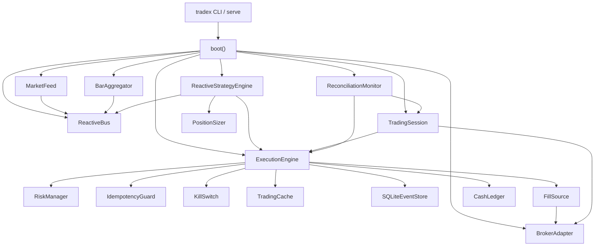

# TradeX v4 — Architecture, Tree & Flows

> **How this document was produced.** §2 is a complete git-tracked file tree
> (1,211 leaves, duplicates included, nothing deduplicated). §2.1 and §2.2 each
> list all 381 production `src/` leaves again under architecture layers and
> component ownership — intentional triple listing. §2.2.1 names every duplicate
> basename and every path that carries it. Gate numbers in §9 were measured on
> this tree. Where this document and `README.md` disagree, this document is
> correct (see §11).

---

## 1. What this is

A broker-agnostic algorithmic trading platform for Indian markets (NSE, BSE,
NFO, MCX, CDS) with live adapters for **Dhan** and **Upstox**, plus a
simulated **Paper** broker.

Core design commitments:

| Commitment | Where it lives | Enforced by |
|---|---|---|
| Frozen dataclasses everywhere — no accidental mutation in event streams | `domain/value_objects.py`, `domain/execution.py` | `tests/test_complexity_gate.py`, review |
| `Decimal` for all money — no float drift in price, qty, P&L | `domain/value_objects.py` | `domain/position_math.py` contract suite |
| Capability-loud adapters — closed by default, typed `SDKError` on the unsupported | `brokers/common/capabilities.py` | `trading/tests/parity` |
| `FillSource` seam — swap Simulated/Paper/Broker/Replay without touching the engine | `execution/fill_sources.py` | parity gate |
| **One path to the venue** — `ExecutionEngine.submit()` is the only door (AC-22) | `execution/engine.py` | `tests/test_import_boundaries.py`, parity gate |
| Shared trading calendar, not per-mode literals | `domain/trading_calendar.py` | `brokers/tests/test_paper_realism_gates.py` |

---

## 2. Repository tree

Complete **git-tracked** inventory to leaf level. Nothing deduplicated — if the
same basename appears in 53 directories (`__init__.py`), each path is listed
separately. Untracked local state (`data/`, `.venv/`, token files) is omitted
because it is not in git.

```
v4/  (1,211 git-tracked files, listed as-is — duplicates included)
├── .agents/
│   └── skills/
│       ├── architect/
│       │   ├── agent-modes/
│       │   │   ├── architecture.md
│       │   │   ├── cross-cutting.md
│       │   │   ├── enhancement.md
│       │   │   └── feature.md
│       │   ├── agents/
│       │   │   └── openai.yaml
│       │   ├── internal/
│       │   │   ├── after-subagent.md
│       │   │   ├── design-conversation.md
│       │   │   └── tool-discovery.md
│       │   ├── SKILL.md
│       │   ├── agent-prompt.md
│       │   └── spec-template.md
│       ├── dispatching-parallel-agents/
│       │   └── SKILL.md
│       └── requesting-code-review/
│           ├── SKILL.md
│           └── code-reviewer.md
├── .claude/
│   ├── skills/
│   │   ├── graphify/
│   │   │   ├── references/
│   │   │   │   ├── add-watch.md
│   │   │   │   ├── exports.md
│   │   │   │   ├── extraction-spec.md
│   │   │   │   ├── github-and-merge.md
│   │   │   │   ├── hooks.md
│   │   │   │   ├── query.md
│   │   │   │   ├── transcribe.md
│   │   │   │   └── update.md
│   │   │   ├── .graphify_version
│   │   │   └── SKILL.md
│   │   ├── architect
│   │   ├── dispatching-parallel-agents
│   │   └── requesting-code-review
│   ├── CLAUDE.md
│   └── settings.json
├── .crush/
│   └── skills/
│       └── architect
├── .github/
│   └── workflows/
│       ├── parity.yml
│       └── quality-gate.yml
├── .pi/
│   └── skills/
│       └── architect
├── .qoder/
│   └── skills/
│       └── architect
├── .trae/
│   └── skills/
│       └── architect
├── Dependencies/
│   ├── nifty100_list.csv
│   ├── nifty200_list.csv
│   ├── nifty500_list.csv
│   ├── nifty50_list.csv
│   └── nse_delistings.csv
├── analytics/
│   ├── src/
│   │   └── tradex_analytics/
│   │       ├── goldens/
│   │       │   ├── adl.json
│   │       │   ├── adx.json
│   │       │   ├── alligator.json
│   │       │   ├── alma.json
│   │       │   ├── alphatrend.json
│   │       │   ├── aroon-oscillator.json
│   │       │   ├── aroon.json
│   │       │   ├── atr.json
│   │       │   ├── average-daily-range.json
│   │       │   ├── awesome-oscillator.json
│   │       │   ├── balance-of-power.json
│   │       │   ├── bb-trend.json
│   │       │   ├── bollinger-bandwidth.json
│   │       │   ├── bollinger-percent-b.json
│   │       │   ├── bollinger.json
│   │       │   ├── cci.json
│   │       │   ├── chaikin-money-flow.json
│   │       │   ├── chaikin-oscillator.json
│   │       │   ├── chande-kroll-stop.json
│   │       │   ├── chande-momentum.json
│   │       │   ├── chandelier-exit.json
│   │       │   ├── chop-zone.json
│   │       │   ├── choppiness-index.json
│   │       │   ├── connors-rsi.json
│   │       │   ├── coppock-curve.json
│   │       │   ├── cpr.json
│   │       │   ├── dema.json
│   │       │   ├── donchian.json
│   │       │   ├── dpo.json
│   │       │   ├── ease-of-movement.json
│   │       │   ├── elder-force-index.json
│   │       │   ├── ema.json
│   │       │   ├── envelope.json
│   │       │   ├── fisher-transform.json
│   │       │   ├── halftrend.json
│   │       │   ├── historical-volatility.json
│   │       │   ├── hma.json
│   │       │   ├── ichimoku.json
│   │       │   ├── kama.json
│   │       │   ├── keltner-channel.json
│   │       │   ├── klinger-oscillator.json
│   │       │   ├── know-sure-thing.json
│   │       │   ├── lsma.json
│   │       │   ├── ma-cross.json
│   │       │   ├── ma-ribbon.json
│   │       │   ├── macd.json
│   │       │   ├── mass-index.json
│   │       │   ├── mcginley-dynamic.json
│   │       │   ├── median.json
│   │       │   ├── mfi.json
│   │       │   ├── momentum.json
│   │       │   ├── nvi.json
│   │       │   ├── obv.json
│   │       │   ├── parabolic-sar.json
│   │       │   ├── ppo.json
│   │       │   ├── pvi.json
│   │       │   ├── pvo.json
│   │       │   ├── pvt.json
│   │       │   ├── range-analysis.json
│   │       │   ├── relative-vigor-index.json
│   │       │   ├── relative-volatility-index.json
│   │       │   ├── roc.json
│   │       │   ├── rsi-divergence.json
│   │       │   ├── rsi.json
│   │       │   ├── sma.json
│   │       │   ├── smi-ergodic-indicator.json
│   │       │   ├── smi-ergodic-oscillator.json
│   │       │   ├── smi.json
│   │       │   ├── special-k.json
│   │       │   ├── stochastic-rsi.json
│   │       │   ├── stochastic.json
│   │       │   ├── supertrend.json
│   │       │   ├── tema.json
│   │       │   ├── trend-strength-index.json
│   │       │   ├── trix.json
│   │       │   ├── tsi.json
│   │       │   ├── twap.json
│   │       │   ├── ulcer-index.json
│   │       │   ├── ultimate-oscillator.json
│   │       │   ├── volatility-stop.json
│   │       │   ├── volume.json
│   │       │   ├── vortex.json
│   │       │   ├── vwap.json
│   │       │   ├── vwma.json
│   │       │   ├── wavetrend.json
│   │       │   ├── williams-fractals.json
│   │       │   ├── williams-percent-r.json
│   │       │   ├── williams-vix-fix.json
│   │       │   ├── wma.json
│   │       │   └── woodies-cci.json
│   │       ├── oscillators/
│   │       │   ├── __init__.py
│   │       │   ├── oscillators_range_a.py
│   │       │   ├── oscillators_range_b.py
│   │       │   ├── oscillators_strength.py
│   │       │   └── oscillators_trend.py
│   │       ├── studies/
│   │       │   ├── __init__.py
│   │       │   ├── studies_complex.py
│   │       │   ├── studies_signals.py
│   │       │   ├── studies_simple.py
│   │       │   └── studies_trend.py
│   │       ├── volatility/
│   │       │   ├── __init__.py
│   │       │   ├── volatility.py
│   │       │   ├── volatility_bands.py
│   │       │   ├── volatility_chop.py
│   │       │   └── volatility_stops.py
│   │       ├── volume/
│   │       │   ├── __init__.py
│   │       │   ├── volume_flow.py
│   │       │   ├── volume_indices.py
│   │       │   ├── volume_profile.py
│   │       │   └── volume_simple.py
│   │       ├── __init__.py
│   │       ├── band_overlays.py
│   │       ├── breadth.py
│   │       ├── engine.py
│   │       ├── footprint.py
│   │       ├── indicators.py
│   │       ├── ma_vol.py
│   │       ├── median_study.py
│   │       ├── orderflow.py
│   │       ├── probability.py
│   │       ├── profiles.py
│   │       ├── py.typed
│   │       ├── registry.py
│   │       ├── reports.py
│   │       ├── research_validity.py
│   │       ├── seasonality.py
│   │       ├── trade_metrics.py
│   │       ├── transforms.py
│   │       └── validation_report.py
│   ├── tests/
│   │   ├── test_analytics_package_import.py
│   │   ├── test_package_exports.py
│   │   ├── test_research_validity.py
│   │   └── test_validation_report.py
│   └── pyproject.toml
├── application/
│   ├── src/
│   │   └── tradex_application/
│   │       ├── __init__.py
│   │       ├── orders.py
│   │       └── py.typed
│   ├── tests/
│   │   └── test_application_package_import.py
│   └── pyproject.toml
├── apps/
│   └── top_gainers/
│       └── app.py
├── benchmarks/
│   ├── bench_bus_throughput.py
│   ├── bench_order_path.py
│   ├── bench_parallel_fetcher.py
│   └── bench_tick_parse.py
├── brokers/
│   ├── src/
│   │   └── tradex_brokers/
│   │       ├── common/
│   │       │   ├── __init__.py
│   │       │   ├── auth.py
│   │       │   ├── base.py
│   │       │   ├── cache.py
│   │       │   ├── capabilities.py
│   │       │   ├── client_shared.py
│   │       │   ├── dhan_segments.py
│   │       │   ├── endpoints.py
│   │       │   ├── http_response.py
│   │       │   ├── instruments.py
│   │       │   ├── market_builders.py
│   │       │   ├── mixins/
│   │       │   │   ├── __init__.py
│   │       │   │   ├── admin.py
│   │       │   │   ├── marketdata.py
│   │       │   │   ├── orders.py
│   │       │   │   └── portfolio.py
│   │       │   ├── paths.py
│   │       │   ├── provider_client.py
│   │       │   ├── provider_common.py
│   │       │   ├── resilience.py
│   │       │   ├── streaming.py
│   │       │   ├── token_lifecycle.py
│   │       │   ├── totp_cooldown.py
│   │       │   ├── transport.py
│   │       │   ├── ws_reconnect.py
│   │       │   └── ws_shared.py
│   │       ├── dhan/
│   │       │   ├── __init__.py
│   │       │   ├── _admin.py
│   │       │   ├── _facade.py
│   │       │   ├── _marketdata.py
│   │       │   ├── _orders.py
│   │       │   ├── _portfolio.py
│   │       │   ├── adapter.py
│   │       │   ├── auth_flow.py
│   │       │   ├── capabilities.py
│   │       │   ├── client.py
│   │       │   ├── depth_parser.py
│   │       │   ├── instruments.py
│   │       │   ├── master.py
│   │       │   ├── rate_table.py
│   │       │   ├── tick_parser.py
│   │       │   └── ws_streams.py
│   │       ├── paper/
│   │       │   ├── __init__.py
│   │       │   ├── adapter.py
│   │       │   ├── capabilities.py
│   │       │   └── rate_table.py
│   │       ├── proto/
│   │       │   ├── MarketDataFeed_pb2.py
│   │       │   └── __init__.py
│   │       ├── upstox/
│   │       │   ├── __init__.py
│   │       │   ├── _admin.py
│   │       │   ├── _alerts.py
│   │       │   ├── _facade.py
│   │       │   ├── _marketdata.py
│   │       │   ├── _orders.py
│   │       │   ├── _portfolio.py
│   │       │   ├── adapter.py
│   │       │   ├── auth_flow.py
│   │       │   ├── capabilities.py
│   │       │   ├── client.py
│   │       │   ├── instruments.py
│   │       │   ├── master.py
│   │       │   ├── rate_table.py
│   │       │   ├── ws_decoder.py
│   │       │   └── ws_streams.py
│   │       ├── __init__.py
│   │       └── py.typed
│   ├── tests/
│   │   ├── common/
│   │   │   ├── __init__.py
│   │   │   ├── test_auth_cache.py
│   │   │   ├── test_auth_utils.py
│   │   │   ├── test_base_broker_passthrough_wall.py
│   │   │   ├── test_broker_contracts.py
│   │   │   ├── test_capability_anchoring.py
│   │   │   ├── test_client_seam.py
│   │   │   ├── test_client_shared.py
│   │   │   ├── test_credential_file_permissions.py
│   │   │   ├── test_http_response.py
│   │   │   ├── test_infra_core.py
│   │   │   ├── test_provider_client.py
│   │   │   ├── test_read_cache.py
│   │   │   ├── test_resilience.py
│   │   │   ├── test_resilience_wiring.py
│   │   │   ├── test_runtime_root.py
│   │   │   ├── test_shared_helpers.py
│   │   │   ├── test_status_code_chain.py
│   │   │   ├── test_streaming.py
│   │   │   ├── test_submit_mutation_uncertain.py
│   │   │   ├── test_token_lifecycle.py
│   │   │   ├── test_totp_cooldown.py
│   │   │   ├── test_transport_error_handling.py
│   │   │   ├── test_ws_heartbeat.py
│   │   │   ├── test_ws_reconnect_hook.py
│   │   │   └── test_ws_resilience.py
│   │   ├── dhan/
│   │   │   └── __init__.py
│   │   ├── paper/
│   │   │   └── __init__.py
│   │   ├── support/
│   │   │   ├── __init__.py
│   │   │   ├── fake_fetch.py
│   │   │   └── fetch_pipeline.py
│   │   ├── upstox/
│   │   │   └── __init__.py
│   │   ├── test_dhan_adapter.py
│   │   ├── test_dhan_client.py
│   │   ├── test_dhan_exchange_segments.py
│   │   ├── test_dhan_tick_parser.py
│   │   ├── test_history_memory_efficiency.py
│   │   ├── test_master_parsers.py
│   │   ├── test_paper_broker_no_trading_import.py
│   │   ├── test_paper_broker_symmetry.py
│   │   ├── test_paper_order_book.py
│   │   ├── test_provider_client_smoke.py
│   │   ├── test_stream_reconnect_harness.py
│   │   ├── test_token_lifecycle.py
│   │   ├── test_upstox_adapter.py
│   │   ├── test_upstox_client.py
│   │   └── test_v3_port.py
│   └── pyproject.toml
├── config/
│   ├── src/
│   │   └── tradex_config/
│   │       ├── __init__.py
│   │       ├── env.py
│   │       ├── permissions.py
│   │       ├── py.typed
│   │       └── schema.py
│   ├── tests/
│   │   ├── test_config_package_import.py
│   │   ├── test_feed_instruments.py
│   │   ├── test_runtime_dir_resolution.py
│   │   └── test_secret_file_permissions.py
│   └── pyproject.toml
├── data/
│   └── .sync_blacklist.json
├── deploy/
│   ├── Dockerfile
│   ├── alertmanager.yml
│   ├── compose.yml
│   ├── healthcheck.py
│   ├── prometheus-rules.yml
│   ├── prometheus.yml
│   └── webhook-receiver.py
├── docs/
│   ├── archive/
│   │   ├── 2026-08/
│   │   │   ├── architecture-design-review-2026-08-29.md
│   │   │   ├── code-review-2026-08-29.md
│   │   │   └── verification-review-2026-08-29.md
│   │   └── 2026-09/
│   │       ├── architecture-flow-verification-2026-09-04.md
│   │       ├── architecture-flows-deep-dive-2026-09-04.md
│   │       ├── execution-state-fix-status-2026-09-01.md
│   │       ├── execution-state-review-2026-09-01.md
│   │       ├── principal-architecture-review-2026-09-04.md
│   │       └── quant-finding-verification-2026-09-07.md
│   ├── audit/
│   │   ├── 2026-09-27-full-platform-review.md
│   │   └── pattern-a-scattered-constants.md
│   ├── audits/
│   │   └── 2026-09/
│   │       ├── 2026-09-26-deep-review-findings.md
│   │       ├── 2026-09-26-predeploy-plan.md
│   │       ├── 2026-09-26-predeploy-review.md
│   │       ├── README.md
│   │       ├── dead-code-analysis.md
│   │       ├── lane-4a-feasibility.md
│   │       ├── operational-minimum-plan.md
│   │       ├── pending-work-inventory.md
│   │       └── programme-closeout.md
│   ├── design/
│   │   ├── 2026-09-13-backtest-engine-discovery.md
│   │   ├── 2026-09-13-backtest-results-surface.md
│   │   ├── 2026-09-13-frontend-integration-map.md
│   │   ├── 2026-09-13-single-store-persistence.md
│   │   ├── 2026-09-13-stale-artifact-verification.md
│   │   ├── 2026-09-13-trades-table.md
│   │   ├── 2026-09-13-workspace-view-restore.md
│   │   ├── 2026-09-15-volume-profile-execution.md
│   │   └── state.md
│   ├── diagrams/
│   │   ├── architecture.json
│   │   ├── target-architecture.html
│   │   ├── target-architecture.json
│   │   ├── target-order-flow.html
│   │   ├── target-order-flow.sequence.json
│   │   └── tradex-architecture.html
│   ├── operations/
│   │   ├── runbooks/
│   │   │   ├── broker-disconnect.md
│   │   │   ├── database-failure.md
│   │   │   ├── oms-recovery.md
│   │   │   ├── reconciliation-drift.md
│   │   │   ├── risk-halt.md
│   │   │   ├── stale-feed.md
│   │   │   └── unknown-submission.md
│   │   └── metrics-catalog.md
│   ├── specs/
│   │   ├── 0002-production-readiness-programme/
│   │   │   ├── index.md
│   │   │   └── rationale.md
│   │   ├── 0003-typed-api-wire-contract/
│   │   │   ├── index.md
│   │   │   └── rationale.md
│   │   ├── 0001-deepen-parquet-market-history.md
│   │   └── remediation-and-hardening.md
│   ├── superpowers/
│   │   ├── plans/
│   │   │   ├── 2026-09-04-execution-hardening-and-safety-fixes.md
│   │   │   ├── 2026-09-08-indicator-parity-2-1-0-plan.md
│   │   │   ├── 2026-09-09-frontend-host-plan.md
│   │   │   ├── 2026-09-21-simple-sync-consolidation.md
│   │   │   ├── 2026-09-22-audit-remediation-plan.md
│   │   │   ├── 2026-09-22-dhan-only-sync.md
│   │   │   ├── 2026-09-22-symbol-mapping-resolve.md
│   │   │   ├── 2026-09-23-deepen-parquet-market-history.md
│   │   │   ├── 2026-09-23-phased-app-remediation.md
│   │   │   ├── 2026-09-24-broker-auth-retry-boot-gate.md
│   │   │   ├── 2026-09-24-package-extraction-waves.md
│   │   │   ├── 2026-09-24-pending-dependency-graph.md
│   │   │   ├── 2026-09-24-solid-platform-mega.md
│   │   │   ├── 2026-09-25-audit-remediation.md
│   │   │   ├── 2026-09-25-fail-closed-money.md
│   │   │   ├── 2026-09-25-money-path-review-findings.md
│   │   │   ├── 2026-09-28-recon-adoption-redesign.md
│   │   │   ├── 2026-09-28-recon-implementation-plan.md
│   │   │   ├── 2026-09-28-recon-quant-risk.md
│   │   │   └── 2026-09-28-recon-verification.md
│   │   └── specs/
│   │       ├── 2026-09-08-indicator-parity-2-1-0-design.md
│   │       ├── 2026-09-09-depth-conformance-design.md
│   │       ├── 2026-09-09-study-strategies-design.md
│   │       ├── 2026-09-09-workspace-persistence-design.md
│   │       ├── 2026-09-09-ws-indicator-push-design.md
│   │       ├── 2026-09-22-audit-remediation-design.md
│   │       ├── 2026-09-22-cleanup-overhaul-design.md
│   │       ├── 2026-09-22-dhan-only-sync-design.md
│   │       ├── 2026-09-22-symbol-mapping-resolve-design.md
│   │       ├── 2026-09-23-phased-app-remediation-design.md
│   │       ├── 2026-09-23-production-authentication-design.md
│   │       ├── 2026-09-24-package-extraction-design.md
│   │       ├── 2026-09-24-package-extraction-wave1-report.md
│   │       ├── 2026-09-24-solid-platform-mega-design.md
│   │       ├── 2026-09-29-production-readiness-fixes-design.md
│   │       └── 2026-09-29-production-readiness-programme-design.md
│   ├── ARCHITECTURAL-AUDIT-2026-09-25.md
│   ├── ARCHITECTURE.md
│   ├── README.md
│   ├── architecture-review.md
│   ├── deep-refactor-plan.md
│   ├── proposed-target-architecture.md
│   └── target-architecture-design.md
├── domain/
│   ├── src/
│   │   └── tradex_domain/
│   │       ├── __init__.py
│   │       ├── capabilities.py
│   │       ├── datetime_formats.py
│   │       ├── enums.py
│   │       ├── errors.py
│   │       ├── events.py
│   │       ├── execution.py
│   │       ├── instrument_lifecycle.py
│   │       ├── instruments.py
│   │       ├── market.py
│   │       ├── market_calendar.py
│   │       ├── options.py
│   │       ├── paths.py
│   │       ├── position_math.py
│   │       ├── protocols.py
│   │       ├── py.typed
│   │       ├── risk_budget.py
│   │       ├── serialization.py
│   │       ├── strategy.py
│   │       ├── timeframe.py
│   │       ├── timezones.py
│   │       ├── trading_calendar.py
│   │       ├── universe.py
│   │       ├── utils.py
│   │       ├── value_objects.py
│   │       └── wire.py
│   ├── tests/
│   │   ├── test_datetime_formats.py
│   │   ├── test_domain_enrichments.py
│   │   ├── test_enum_registration.py
│   │   ├── test_instrument_id.py
│   │   ├── test_instrument_id_parsing.py
│   │   ├── test_instrument_key_expiry_format.py
│   │   ├── test_market_calendar.py
│   │   ├── test_market_enrichments.py
│   │   ├── test_order_request_validation.py
│   │   ├── test_order_result_validation.py
│   │   ├── test_order_transitions.py
│   │   ├── test_position_math.py
│   │   ├── test_registry_consolidation.py
│   │   ├── test_registry_key_semantics.py
│   │   ├── test_serialization_roundtrip.py
│   │   ├── test_universe_csv_dir.py
│   │   ├── test_value_object_arithmetic.py
│   │   └── test_value_validation.py
│   └── pyproject.toml
├── execution/
│   ├── src/
│   │   └── tradex_execution/
│   │       ├── __init__.py
│   │       ├── cash_ledger.py
│   │       ├── engine.py
│   │       ├── envelopes.py
│   │       ├── fees.py
│   │       ├── fill_model.py
│   │       ├── fill_sources.py
│   │       ├── idempotency.py
│   │       ├── kill_switch.py
│   │       ├── mark_to_market.py
│   │       ├── order_manager.py
│   │       ├── position_accountant.py
│   │       ├── position_manager.py
│   │       ├── projection.py
│   │       ├── py.typed
│   │       ├── reconciliation.py
│   │       ├── recovery.py
│   │       ├── risk.py
│   │       ├── risk_baseline_store.py
│   │       ├── slippage.py
│   │       ├── sqlite_event_store.py
│   │       ├── sqlite_store.py
│   │       ├── trading_cache.py
│   │       └── validation_report_store.py
│   ├── tests/
│   │   ├── test_event_store_account_scope.py
│   │   ├── test_event_store_fill_dedup.py
│   │   ├── test_event_store_snapshots.py
│   │   ├── test_execution_package_import.py
│   │   ├── test_fill_source_contract.py
│   │   ├── test_idempotency_completion_order.py
│   │   ├── test_order_store_thread_safety.py
│   │   ├── test_position_lock_sharing.py
│   │   └── test_validation_report_store.py
│   └── pyproject.toml
├── interfaces/
│   ├── src/
│   │   └── tradex_interfaces/
│   │       ├── auth/
│   │       │   ├── __init__.py
│   │       │   ├── csrf.py
│   │       │   ├── deps.py
│   │       │   ├── origin.py
│   │       │   ├── rate_limit.py
│   │       │   ├── routes.py
│   │       │   └── session_store.py
│   │       ├── routes/
│   │       │   ├── __init__.py
│   │       │   ├── _market_helpers.py
│   │       │   ├── account.py
│   │       │   ├── chart.py
│   │       │   ├── deps.py
│   │       │   ├── extensions.py
│   │       │   ├── health.py
│   │       │   ├── market_data.py
│   │       │   ├── orders.py
│   │       │   ├── portfolio.py
│   │       │   ├── stream.py
│   │       │   └── stream_indicators.py
│   │       ├── __init__.py
│   │       ├── _helpers.py
│   │       ├── cli.py
│   │       ├── fastapi_app.py
│   │       ├── models.py
│   │       ├── py.typed
│   │       ├── queueing.py
│   │       ├── replay_guard.py
│   │       ├── replay_run.py
│   │       ├── safety.py
│   │       ├── safety_report_store.py
│   │       └── workspace_store.py
│   ├── tests/
│   │   ├── test_chart_backtest_off_loop.py
│   │   ├── test_graceful_shutdown.py
│   │   └── test_interfaces_package_import.py
│   └── pyproject.toml
├── market_data/
│   ├── src/
│   │   └── tradex_market_data/
│   │       ├── __init__.py
│   │       ├── backtest_loader.py
│   │       ├── catalog.py
│   │       ├── corporate_actions.py
│   │       ├── gap_detector.py
│   │       ├── market_provider.py
│   │       ├── parallel_fetcher.py
│   │       ├── parquet_storage.py
│   │       ├── paths.py
│   │       ├── py.typed
│   │       ├── simple_sync.py
│   │       ├── symbol_resolve.py
│   │       └── universe.py
│   ├── tests/
│   │   ├── parquet_pushdown_bench.py
│   │   ├── test_backtest_loader_pit_guard.py
│   │   ├── test_market_data_package_import.py
│   │   ├── test_parquet_pushdown.py
│   │   ├── test_parquet_quarantine.py
│   │   └── test_pit_universe_artifacts.py
│   └── pyproject.toml
├── observability/
│   ├── src/
│   │   └── tradex_observability/
│   │       ├── __init__.py
│   │       ├── metrics.py
│   │       ├── py.typed
│   │       └── tracing.py
│   ├── tests/
│   │   ├── test_alert_rules.py
│   │   ├── test_deploy_artifacts.py
│   │   ├── test_metrics_labels_buckets.py
│   │   └── test_observability_package_import.py
│   └── pyproject.toml
├── poc/
│   ├── data/
│   │   └── build_0950_dataset.py
│   ├── research/
│   │   ├── duckdb/
│   │   │   ├── backtest_0945.py
│   │   │   ├── chartink_breakout_backtest.csv
│   │   │   ├── chartink_breakout_study.py
│   │   │   ├── condition_breakdown.py
│   │   │   ├── obv_acceptance_study.py
│   │   │   ├── open_drive_criteria_study.py
│   │   │   ├── opening_drive_study.py
│   │   │   ├── rs_dtw_topgainer_study.py
│   │   │   ├── run_6criteria_aug31.py
│   │   │   ├── screener_optimize_study.py
│   │   │   ├── screener_v2_optimize.py
│   │   │   ├── select_0945.py
│   │   │   ├── select_0945_final.py
│   │   │   └── volume_price_entry_study.py
│   │   ├── scan_0945_forward.py
│   │   └── vp_strategy_backtest.py
│   ├── README.md
│   ├── rank_0950.py
│   └── timesfm_0950.py
├── reactive/
│   ├── src/
│   │   └── tradex_reactive/
│   │       ├── __init__.py
│   │       ├── bus.py
│   │       ├── event_log.py
│   │       ├── py.typed
│   │       └── thread_safe_bus.py
│   ├── tests/
│   │   └── test_reactive_package_import.py
│   └── pyproject.toml
├── replay/
│   ├── src/
│   │   └── tradex_replay/
│   │       ├── __init__.py
│   │       ├── backtest.py
│   │       ├── optimization.py
│   │       ├── py.typed
│   │       ├── synthetic_ticks.py
│   │       ├── validation.py
│   │       └── walk_forward.py
│   ├── tests/
│   │   └── test_replay_package_import.py
│   └── pyproject.toml
├── research/
│   ├── src/
│   │   └── tradex_research/
│   │       ├── __init__.py
│   │       ├── manifests.py
│   │       ├── pit.py
│   │       └── py.typed
│   ├── tests/
│   │   ├── test_manifests.py
│   │   └── test_pit.py
│   └── pyproject.toml
├── runtime/
│   ├── src/
│   │   └── tradex_runtime/
│   │       ├── __init__.py
│   │       ├── bar_aggregator.py
│   │       ├── calendar.py
│   │       ├── feed_integrity.py
│   │       ├── feed_monitor.py
│   │       ├── feed_recovery.py
│   │       ├── feed_supervisor.py
│   │       ├── live.py
│   │       ├── live_fill_bridge.py
│   │       ├── logging_config.py
│   │       ├── market_feed.py
│   │       ├── master_lifecycle.py
│   │       ├── metrics.py
│   │       ├── paper_book_fill_source.py
│   │       ├── py.typed
│   │       ├── reconciliation_monitor.py
│   │       ├── session.py
│   │       ├── session_impl.py
│   │       ├── shutdown.py
│   │       ├── startup.py
│   │       ├── streaming.py
│   │       ├── tape_recorder.py
│   │       └── writer_lock.py
│   ├── tests/
│   │   ├── test_domain_constant_adoption.py
│   │   └── test_runtime_package_import.py
│   └── pyproject.toml
├── scripts/
│   ├── coverage_floors.py
│   ├── extract_package.py
│   ├── generate_fixtures.py
│   ├── generate_goldens.mjs
│   ├── generate_goldens_profiles.mjs
│   ├── generate_goldens_transforms.mjs
│   ├── goldens-provenance.mjs
│   ├── hash-tree.mjs
│   ├── library-dist.mjs
│   ├── pin.mjs
│   ├── regenerate-goldens.sh
│   ├── ruff_ratchet.py
│   └── write-provenance.mjs
├── services/
│   └── duckdb-analytics/
│       ├── src/
│       │   └── duck_analytics/
│       │       ├── mcp/
│       │       │   ├── __init__.py
│       │       │   └── server.py
│       │       ├── __init__.py
│       │       ├── catalog.py
│       │       ├── config.py
│       │       ├── patterns.py
│       │       ├── query.py
│       │       ├── resample.py
│       │       ├── rs_score.py
│       │       ├── scanners.py
│       │       ├── screener.py
│       │       └── testing.py
│       ├── tests/
│       │   ├── conftest.py
│       │   ├── test_catalog.py
│       │   ├── test_query_guards.py
│       │   ├── test_resample.py
│       │   ├── test_rs_dtw.py
│       │   └── test_scanners.py
│       ├── README.md
│       ├── pyproject.toml
│       └── uv.lock
├── strategy/
│   ├── src/
│   │   └── tradex_strategy/
│   │       ├── core/
│   │       │   ├── __init__.py
│   │       │   ├── brackets.py
│   │       │   ├── buy_and_hold.py
│   │       │   ├── engine.py
│   │       │   ├── protocols.py
│   │       │   ├── scanner.py
│   │       │   ├── scanner_limits.py
│   │       │   └── sizing.py
│   │       ├── extensions/
│   │       │   ├── scanners/
│   │       │   │   ├── __init__.py
│   │       │   │   ├── momentum.py
│   │       │   │   ├── nifty500_technical.py
│   │       │   │   └── pullback.py
│   │       │   ├── shared/
│   │       │   │   └── __init__.py
│   │       │   ├── strategies/
│   │       │   │   ├── __init__.py
│   │       │   │   ├── bollinger_breakout.py
│   │       │   │   ├── bracket_breakout.py
│   │       │   │   ├── ema_ribbon_pullback.py
│   │       │   │   ├── macd_cross.py
│   │       │   │   ├── mean_reversion.py
│   │       │   │   ├── multi_symbol_sma_cross.py
│   │       │   │   ├── rsi_reversal.py
│   │       │   │   ├── sma_cross.py
│   │       │   │   ├── study_base.py
│   │       │   │   └── supertrend_flip.py
│   │       │   └── __init__.py
│   │       ├── __init__.py
│   │       ├── artifacts.py
│   │       ├── py.typed
│   │       ├── registry.py
│   │       └── runtime.py
│   ├── tests/
│   │   └── test_strategy_package_import.py
│   └── pyproject.toml
├── tests/
│   ├── regression/
│   │   ├── test_broker_timeout_unknown.py
│   │   ├── test_http_auth_data_routes.py
│   │   └── test_sigterm_lifespan_teardown.py
│   ├── runtime_audit/
│   │   ├── test_phase1_bootstrap.py
│   │   ├── test_phase2_leaf_engine.py
│   │   ├── test_phase4_transport.py
│   │   └── test_phase9_failure_modes.py
│   ├── test_complexity_gate.py
│   ├── test_import_boundaries.py
│   ├── test_no_foreign_private_writes.py
│   └── test_parquet_history_seam.py
├── trading/
│   ├── scripts/
│   │   ├── audit_symbol_resolution.py
│   │   ├── backfill_2025.py
│   │   ├── backfill_parquet.py
│   │   ├── backtest_datalake.py
│   │   ├── clean_datalake.py
│   │   ├── datalake_stats.py
│   │   ├── e2e_smoke.py
│   │   ├── fill_gaps.py
│   │   ├── quick_start_live.py
│   │   ├── reconcile_bars.py
│   │   ├── rename_symbol.py
│   │   ├── repair_gaps.py
│   │   ├── seed_e2e_datalake.py
│   │   ├── sync_today.py
│   │   └── topup_gaps.py
│   ├── tests/
│   │   ├── analytics/
│   │   │   ├── goldens/
│   │   │   │   ├── profiles/
│   │   │   │   │   ├── footprint.json
│   │   │   │   │   ├── market-profile.json
│   │   │   │   │   ├── seasonality.json
│   │   │   │   │   ├── tpo.json
│   │   │   │   │   └── volume-profile.json
│   │   │   │   ├── settings2/
│   │   │   │   │   ├── variantA/
│   │   │   │   │   │   ├── adx.json
│   │   │   │   │   │   ├── atr.json
│   │   │   │   │   │   ├── bollinger.json
│   │   │   │   │   │   ├── chaikin-volatility.json
│   │   │   │   │   │   ├── ema.json
│   │   │   │   │   │   ├── hma.json
│   │   │   │   │   │   ├── hull-suite.json
│   │   │   │   │   │   ├── macd.json
│   │   │   │   │   │   ├── parabolic-sar.json
│   │   │   │   │   │   ├── rsi.json
│   │   │   │   │   │   ├── sma.json
│   │   │   │   │   │   ├── standard-error-bands.json
│   │   │   │   │   │   ├── supertrend.json
│   │   │   │   │   │   ├── t3.json
│   │   │   │   │   │   └── vwap.json
│   │   │   │   │   └── variantB/
│   │   │   │   │       ├── adx.json
│   │   │   │   │       ├── atr.json
│   │   │   │   │       ├── bollinger.json
│   │   │   │   │       ├── chaikin-volatility.json
│   │   │   │   │       ├── ema.json
│   │   │   │   │       ├── hma.json
│   │   │   │   │       ├── hull-suite.json
│   │   │   │   │       ├── macd.json
│   │   │   │   │       ├── parabolic-sar.json
│   │   │   │   │       ├── rsi.json
│   │   │   │   │       ├── sma.json
│   │   │   │   │       ├── standard-error-bands.json
│   │   │   │   │       ├── supertrend.json
│   │   │   │   │       ├── t3.json
│   │   │   │   │       └── vwap.json
│   │   │   │   ├── transforms/
│   │   │   │   │   ├── heikin-ashi.json
│   │   │   │   │   ├── kagi.json
│   │   │   │   │   ├── line-break.json
│   │   │   │   │   ├── point-figure.json
│   │   │   │   │   ├── range-bars.json
│   │   │   │   │   └── renko.json
│   │   │   │   ├── PROVENANCE.json
│   │   │   │   ├── adl.json
│   │   │   │   ├── adx.json
│   │   │   │   ├── alligator.json
│   │   │   │   ├── alma.json
│   │   │   │   ├── alphatrend.json
│   │   │   │   ├── aroon-oscillator.json
│   │   │   │   ├── aroon.json
│   │   │   │   ├── atr.json
│   │   │   │   ├── average-daily-range.json
│   │   │   │   ├── awesome-oscillator.json
│   │   │   │   ├── balance-of-power.json
│   │   │   │   ├── bb-trend.json
│   │   │   │   ├── bollinger-bandwidth.json
│   │   │   │   ├── bollinger-percent-b.json
│   │   │   │   ├── bollinger.json
│   │   │   │   ├── cci.json
│   │   │   │   ├── chaikin-money-flow.json
│   │   │   │   ├── chaikin-oscillator.json
│   │   │   │   ├── chaikin-volatility.json
│   │   │   │   ├── chande-kroll-stop.json
│   │   │   │   ├── chande-momentum.json
│   │   │   │   ├── chandelier-exit.json
│   │   │   │   ├── chop-zone.json
│   │   │   │   ├── choppiness-index.json
│   │   │   │   ├── connors-rsi.json
│   │   │   │   ├── consolidation-breakout.json
│   │   │   │   ├── coppock-curve.json
│   │   │   │   ├── cpr.json
│   │   │   │   ├── dema.json
│   │   │   │   ├── donchian.json
│   │   │   │   ├── dpo.json
│   │   │   │   ├── ease-of-movement.json
│   │   │   │   ├── elder-force-index.json
│   │   │   │   ├── ema.json
│   │   │   │   ├── envelope.json
│   │   │   │   ├── fisher-transform.json
│   │   │   │   ├── fixtures.json
│   │   │   │   ├── halftrend.json
│   │   │   │   ├── historical-volatility.json
│   │   │   │   ├── hma.json
│   │   │   │   ├── hull-suite.json
│   │   │   │   ├── ichimoku.json
│   │   │   │   ├── kama.json
│   │   │   │   ├── keltner-channel.json
│   │   │   │   ├── klinger-oscillator.json
│   │   │   │   ├── know-sure-thing.json
│   │   │   │   ├── linreg-slope.json
│   │   │   │   ├── lsma.json
│   │   │   │   ├── ma-channel.json
│   │   │   │   ├── ma-cross.json
│   │   │   │   ├── ma-ribbon.json
│   │   │   │   ├── macd.json
│   │   │   │   ├── mass-index.json
│   │   │   │   ├── mcginley-dynamic.json
│   │   │   │   ├── median.json
│   │   │   │   ├── mfi.json
│   │   │   │   ├── momentum.json
│   │   │   │   ├── net-volume.json
│   │   │   │   ├── nvi.json
│   │   │   │   ├── obv.json
│   │   │   │   ├── parabolic-sar.json
│   │   │   │   ├── ppo.json
│   │   │   │   ├── pvi.json
│   │   │   │   ├── pvo.json
│   │   │   │   ├── pvt.json
│   │   │   │   ├── range-analysis.json
│   │   │   │   ├── relative-vigor-index.json
│   │   │   │   ├── relative-volatility-index.json
│   │   │   │   ├── roc.json
│   │   │   │   ├── rsi-divergence.json
│   │   │   │   ├── rsi.json
│   │   │   │   ├── seasonality.json
│   │   │   │   ├── sma.json
│   │   │   │   ├── smi-ergodic-indicator.json
│   │   │   │   ├── smi-ergodic-oscillator.json
│   │   │   │   ├── smi.json
│   │   │   │   ├── smma.json
│   │   │   │   ├── special-k.json
│   │   │   │   ├── standard-deviation.json
│   │   │   │   ├── standard-error-bands.json
│   │   │   │   ├── standard-error.json
│   │   │   │   ├── stochastic-rsi.json
│   │   │   │   ├── stochastic.json
│   │   │   │   ├── supertrend.json
│   │   │   │   ├── t3.json
│   │   │   │   ├── tema.json
│   │   │   │   ├── trend-strength-index.json
│   │   │   │   ├── trix.json
│   │   │   │   ├── tsi.json
│   │   │   │   ├── twap.json
│   │   │   │   ├── ulcer-index.json
│   │   │   │   ├── ultimate-oscillator.json
│   │   │   │   ├── volatility-stop.json
│   │   │   │   ├── volume.json
│   │   │   │   ├── vortex.json
│   │   │   │   ├── vwap.json
│   │   │   │   ├── vwma.json
│   │   │   │   ├── wavetrend.json
│   │   │   │   ├── williams-fractals.json
│   │   │   │   ├── williams-percent-r.json
│   │   │   │   ├── williams-vix-fix.json
│   │   │   │   ├── wma.json
│   │   │   │   └── woodies-cci.json
│   │   │   ├── __init__.py
│   │   │   ├── engine-inputs-2_1_0.json
│   │   │   ├── test_analytics.py
│   │   │   ├── test_annualisation_constants.py
│   │   │   ├── test_breadth_indicator.py
│   │   │   ├── test_cvd.py
│   │   │   ├── test_engine_gaps.py
│   │   │   ├── test_engine_historical.py
│   │   │   ├── test_footprint.py
│   │   │   ├── test_frontend_contract_parity.py
│   │   │   ├── test_golden_parity.py
│   │   │   ├── test_golden_parity_profiles.py
│   │   │   ├── test_golden_parity_transforms.py
│   │   │   ├── test_goldens_provenance.py
│   │   │   ├── test_indicator_registry.py
│   │   │   ├── test_parity_settings_21.py
│   │   │   ├── test_seasonality_endpoint.py
│   │   │   ├── test_tearsheet.py
│   │   │   ├── test_tier2_contract_2_1_0.py
│   │   │   ├── test_trade_metrics.py
│   │   │   └── test_volume_profile_extended.py
│   │   ├── application/
│   │   │   ├── __init__.py
│   │   │   └── test_orders.py
│   │   ├── contracts/
│   │   │   ├── __init__.py
│   │   │   ├── test_ac22_single_path_to_venue.py
│   │   │   ├── test_adapter_protocol.py
│   │   │   ├── test_cache_interface_unification.py
│   │   │   ├── test_cqrs_signal_to_order.py
│   │   │   ├── test_domain_contract.py
│   │   │   ├── test_historical_series.py
│   │   │   ├── test_instruments_options.py
│   │   │   ├── test_order_write_contract.py
│   │   │   ├── test_pending_edges.py
│   │   │   ├── test_principal_fixes.py
│   │   │   ├── test_session_anchored_buckets.py
│   │   │   ├── test_session_smoke.py
│   │   │   ├── test_side_enum_identity.py
│   │   │   └── test_value_objects_serialization.py
│   │   ├── datalake/
│   │   │   ├── __init__.py
│   │   │   ├── test_analytics_datalake.py
│   │   │   ├── test_backtest_loader.py
│   │   │   ├── test_corporate_actions_enhanced.py
│   │   │   ├── test_datalake_root_defaults.py
│   │   │   ├── test_delisting_ledger.py
│   │   │   ├── test_gap_detector.py
│   │   │   ├── test_market_provider.py
│   │   │   ├── test_parallel_fetcher.py
│   │   │   ├── test_parquet_storage.py
│   │   │   ├── test_session_grid_calibration.py
│   │   │   ├── test_simple_sync.py
│   │   │   ├── test_symbol_resolve.py
│   │   │   └── test_universe.py
│   │   ├── execution/
│   │   │   ├── __init__.py
│   │   │   ├── test_append_before_mutate.py
│   │   │   ├── test_applied_fills_lru.py
│   │   │   ├── test_bracket_engine_pipeline.py
│   │   │   ├── test_c3_metrics.py
│   │   │   ├── test_cancel_releases_idempotency.py
│   │   │   ├── test_cash_anchor_integrity.py
│   │   │   ├── test_cash_concurrency_atomicity.py
│   │   │   ├── test_cash_ledger.py
│   │   │   ├── test_cash_ledger_lock_negative_control.py
│   │   │   ├── test_cash_ledger_side_identity.py
│   │   │   ├── test_cqrs_command.py
│   │   │   ├── test_dispatch_requires_durable_intent.py
│   │   │   ├── test_engine_fee_schedule_gate.py
│   │   │   ├── test_engine_fill_race.py
│   │   │   ├── test_engine_gaps.py
│   │   │   ├── test_engine_killswitch_dedup.py
│   │   │   ├── test_engine_metrics.py
│   │   │   ├── test_engine_risk_gaps.py
│   │   │   ├── test_engine_shutdown.py
│   │   │   ├── test_engine_v3_port.py
│   │   │   ├── test_envelopes.py
│   │   │   ├── test_event_store_durability.py
│   │   │   ├── test_event_store_integrity.py
│   │   │   ├── test_event_store_reconstruction.py
│   │   │   ├── test_execution_engine.py
│   │   │   ├── test_execution_engine_edges.py
│   │   │   ├── test_fail_closed_event_store.py
│   │   │   ├── test_fail_closed_feed.py
│   │   │   ├── test_fail_closed_risk.py
│   │   │   ├── test_fee_rounding_mode.py
│   │   │   ├── test_fees_gaps.py
│   │   │   ├── test_fees_pricing.py
│   │   │   ├── test_fees_product_aware.py
│   │   │   ├── test_fees_unified.py
│   │   │   ├── test_fees_v3_port.py
│   │   │   ├── test_fees_validation.py
│   │   │   ├── test_fill_product_type_backfill.py
│   │   │   ├── test_fill_sources.py
│   │   │   ├── test_fill_sources_edges.py
│   │   │   ├── test_fill_sources_gaps.py
│   │   │   ├── test_fill_sources_gaps_2.py
│   │   │   ├── test_fill_sources_v3_port.py
│   │   │   ├── test_idempotency_duplicate_events.py
│   │   │   ├── test_idempotency_guard.py
│   │   │   ├── test_inbound_fill_cash_atomicity.py
│   │   │   ├── test_inbound_fill_durability.py
│   │   │   ├── test_inflight_duplicate.py
│   │   │   ├── test_kill_switch.py
│   │   │   ├── test_kill_switch_cancels_unknown.py
│   │   │   ├── test_kill_switch_venue_first.py
│   │   │   ├── test_live_cancel_reaches_venue.py
│   │   │   ├── test_live_fill_bridge.py
│   │   │   ├── test_live_fill_per_trade_price.py
│   │   │   ├── test_live_fill_stream_bridge.py
│   │   │   ├── test_live_fill_trade_ids.py
│   │   │   ├── test_live_fill_traded_price.py
│   │   │   ├── test_make_order_validates_id.py
│   │   │   ├── test_mark_to_market.py
│   │   │   ├── test_modify_cancel_idempotency.py
│   │   │   ├── test_modify_risk.py
│   │   │   ├── test_oms_crash_recovery.py
│   │   │   ├── test_oms_event_coverage.py
│   │   │   ├── test_order_manager.py
│   │   │   ├── test_order_manager_gaps.py
│   │   │   ├── test_order_modified_persistence.py
│   │   │   ├── test_order_recovery_ordering.py
│   │   │   ├── test_partial_fill_recovery.py
│   │   │   ├── test_per_strategy_budget.py
│   │   │   ├── test_persistence_seam.py
│   │   │   ├── test_position_accountant.py
│   │   │   ├── test_position_manager.py
│   │   │   ├── test_position_manager_gaps.py
│   │   │   ├── test_position_math.py
│   │   │   ├── test_public_module_surface.py
│   │   │   ├── test_reactive_cash_snapshot.py
│   │   │   ├── test_reconciliation.py
│   │   │   ├── test_reconciliation_v3_port.py
│   │   │   ├── test_recovered_marks.py
│   │   │   ├── test_recovery.py
│   │   │   ├── test_remaining_gaps.py
│   │   │   ├── test_risk_baseline_restart.py
│   │   │   ├── test_risk_budget_and_marks.py
│   │   │   ├── test_risk_cash_check.py
│   │   │   ├── test_risk_cash_gate_fails_closed.py
│   │   │   ├── test_risk_cash_unpriced.py
│   │   │   ├── test_risk_session_date_typed.py
│   │   │   ├── test_risk_tz.py
│   │   │   ├── test_seeded_ledger_cash_floor.py
│   │   │   ├── test_slippage.py
│   │   │   ├── test_sqlite_event_store.py
│   │   │   ├── test_sqlite_order_store_live.py
│   │   │   ├── test_sqlite_store.py
│   │   │   ├── test_strategy_id_attribution.py
│   │   │   ├── test_trading_cache.py
│   │   │   ├── test_unknown_outcome_halts.py
│   │   │   └── test_unknown_submission_in_oms.py
│   │   ├── integration/
│   │   │   ├── __init__.py
│   │   │   ├── test_boot_parity.py
│   │   │   ├── test_extensions_boot_wiring.py
│   │   │   └── test_full_stack.py
│   │   ├── interface/
│   │   │   ├── __init__.py
│   │   │   ├── test_account_route_projection.py
│   │   │   ├── test_api_key_header_constant.py
│   │   │   ├── test_audit_identity.py
│   │   │   ├── test_auth_fail_closed.py
│   │   │   ├── test_auth_session_routes.py
│   │   │   ├── test_bracket_order.py
│   │   │   ├── test_chart_backtest.py
│   │   │   ├── test_chart_backtest_cash_gate.py
│   │   │   ├── test_chart_history.py
│   │   │   ├── test_chart_indicators.py
│   │   │   ├── test_chart_symbols.py
│   │   │   ├── test_cli_serve.py
│   │   │   ├── test_cors_csrf_origin_parity.py
│   │   │   ├── test_csrf_enforcement.py
│   │   │   ├── test_csrf_tokens.py
│   │   │   ├── test_datalake_root.py
│   │   │   ├── test_depth_conformance.py
│   │   │   ├── test_error_contract.py
│   │   │   ├── test_fastapi_app.py
│   │   │   ├── test_interface_modules.py
│   │   │   ├── test_live_bind_policy.py
│   │   │   ├── test_metrics_endpoint.py
│   │   │   ├── test_order_product.py
│   │   │   ├── test_order_status_mapping.py
│   │   │   ├── test_portfolio_live_state.py
│   │   │   ├── test_profiles_route.py
│   │   │   ├── test_rate_limit_money.py
│   │   │   ├── test_replay_guard.py
│   │   │   ├── test_replay_order_gate.py
│   │   │   ├── test_safety_adoption.py
│   │   │   ├── test_safety_route.py
│   │   │   ├── test_safety_wiring.py
│   │   │   ├── test_session_store.py
│   │   │   ├── test_transforms_route.py
│   │   │   ├── test_workspace_persistence.py
│   │   │   ├── test_ws_auth.py
│   │   │   ├── test_ws_bars_replay.py
│   │   │   ├── test_ws_feed_status.py
│   │   │   ├── test_ws_indicator_push.py
│   │   │   ├── test_ws_indicator_tail_cache.py
│   │   │   └── test_ws_session_auth.py
│   │   ├── parity/
│   │   │   ├── goldens/
│   │   │   │   └── recon_startup_drift.json
│   │   │   ├── __init__.py
│   │   │   ├── test_backtest_capped_fee_parity.py
│   │   │   ├── test_backtest_live_tape_parity.py
│   │   │   ├── test_bracket_backtest_parity.py
│   │   │   ├── test_chaos_parity.py
│   │   │   ├── test_corporate_action_parity.py
│   │   │   ├── test_cross_provider.py
│   │   │   ├── test_execution_cost_parity.py
│   │   │   ├── test_execution_projection_parity.py
│   │   │   ├── test_golden_all_costs_parity.py
│   │   │   ├── test_golden_mode_parity.py
│   │   │   ├── test_live_tape_parity.py
│   │   │   ├── test_mode_parity_across_paths.py
│   │   │   ├── test_paper_fill_convergence.py
│   │   │   ├── test_paper_session_live.py
│   │   │   ├── test_projection_is_api_contract.py
│   │   │   ├── test_property_parity.py
│   │   │   ├── test_recon_golden.py
│   │   │   ├── test_recording_bridge_guard.py
│   │   │   ├── test_replay_parity.py
│   │   │   ├── test_risk_parity.py
│   │   │   └── test_slippage_vs_book_parity.py
│   │   ├── reactive/
│   │   │   ├── __init__.py
│   │   │   ├── test_bus_backpressure.py
│   │   │   ├── test_bus_error_isolation.py
│   │   │   ├── test_bus_partition.py
│   │   │   ├── test_event_log.py
│   │   │   ├── test_of_type_error_isolation.py
│   │   │   ├── test_post_dispose_publish.py
│   │   │   ├── test_reactive_regression.py
│   │   │   └── test_thread_safe_bus.py
│   │   ├── replay/
│   │   │   ├── __init__.py
│   │   │   ├── test_backtest_cash_atomicity.py
│   │   │   ├── test_backtest_corporate_actions.py
│   │   │   ├── test_backtest_fees.py
│   │   │   ├── test_backtest_no_lookahead.py
│   │   │   ├── test_backtest_real_pnl.py
│   │   │   ├── test_backtest_sharpe_inference.py
│   │   │   ├── test_backtest_sizer_wiring.py
│   │   │   ├── test_backtest_stop_gap.py
│   │   │   ├── test_bridge_protective_levels.py
│   │   │   ├── test_optimization.py
│   │   │   ├── test_replay_backtest.py
│   │   │   ├── test_synthetic_ticks.py
│   │   │   ├── test_synthetic_ticks_depth.py
│   │   │   ├── test_validation_entry_point.py
│   │   │   ├── test_walk_forward.py
│   │   │   └── test_walk_forward_validity.py
│   │   ├── research/
│   │   │   ├── test_manifests.py
│   │   │   └── test_pit.py
│   │   ├── runtime/
│   │   │   ├── __init__.py
│   │   │   ├── conftest.py
│   │   │   ├── test_audit_regressions.py
│   │   │   ├── test_bar_aggregator.py
│   │   │   ├── test_bar_aggregator_late_ticks.py
│   │   │   ├── test_bar_frame_source.py
│   │   │   ├── test_boot_cash_wiring.py
│   │   │   ├── test_boot_cold_start_wiring.py
│   │   │   ├── test_boot_reconcile_before_start.py
│   │   │   ├── test_boot_requires_risk_limits.py
│   │   │   ├── test_boot_rollback.py
│   │   │   ├── test_boot_safety.py
│   │   │   ├── test_broker_close_once.py
│   │   │   ├── test_calendar.py
│   │   │   ├── test_cash_reconciliation.py
│   │   │   ├── test_crash_restart_reconstruction.py
│   │   │   ├── test_durable_provider_integration.py
│   │   │   ├── test_error_occurred_logged.py
│   │   │   ├── test_event_store_crash_restart.py
│   │   │   ├── test_feed_cold_boot.py
│   │   │   ├── test_feed_instruments_boot.py
│   │   │   ├── test_feed_integrity.py
│   │   │   ├── test_feed_monitor.py
│   │   │   ├── test_feed_recovery.py
│   │   │   ├── test_feed_supervisor.py
│   │   │   ├── test_instrument_bootstrap.py
│   │   │   ├── test_live_boot_fail_closed.py
│   │   │   ├── test_live_boots_no_example_strategies.py
│   │   │   ├── test_live_cash_anchor.py
│   │   │   ├── test_live_master_cache.py
│   │   │   ├── test_live_order_kill_switch.py
│   │   │   ├── test_live_token_path.py
│   │   │   ├── test_live_wiring.py
│   │   │   ├── test_market_feed.py
│   │   │   ├── test_market_feed_reconnect_wire.py
│   │   │   ├── test_market_feed_thread_safety.py
│   │   │   ├── test_master_lifecycle.py
│   │   │   ├── test_master_refresh_wiring.py
│   │   │   ├── test_metrics.py
│   │   │   ├── test_metrics_thread_safety.py
│   │   │   ├── test_oms_boot_recovery.py
│   │   │   ├── test_order_stream_watchdog.py
│   │   │   ├── test_post_reconnect_reread.py
│   │   │   ├── test_reconciliation_monitor.py
│   │   │   ├── test_reconciliation_wiring.py
│   │   │   ├── test_session_feed_lifecycle.py
│   │   │   ├── test_shutdown_coordinator.py
│   │   │   ├── test_startup_reconcile_unavailable.py
│   │   │   ├── test_strategy_lifecycle_boot.py
│   │   │   ├── test_structured_logging.py
│   │   │   ├── test_symbol_cadence.py
│   │   │   ├── test_tape_feed_attachment.py
│   │   │   ├── test_tape_recorder.py
│   │   │   ├── test_tape_replay.py
│   │   │   ├── test_trace_logging.py
│   │   │   ├── test_v3_port_gaps.py
│   │   │   └── test_writer_lock_lifecycle.py
│   │   ├── scripts/
│   │   │   ├── __init__.py
│   │   │   ├── test_audit_symbol_resolution.py
│   │   │   ├── test_backfill_parquet.py
│   │   │   ├── test_backtest_datalake.py
│   │   │   ├── test_datalake_root_seam.py
│   │   │   ├── test_datalake_stats.py
│   │   │   └── test_reconcile_bars.py
│   │   ├── sdk/
│   │   │   ├── __init__.py
│   │   │   ├── test_live_fill_bridge_index.py
│   │   │   ├── test_session_edges.py
│   │   │   ├── test_session_factories.py
│   │   │   ├── test_session_lifecycle.py
│   │   │   ├── test_session_provider_data.py
│   │   │   └── test_session_readiness.py
│   │   ├── strategy/
│   │   │   ├── __init__.py
│   │   │   ├── _ac22_recorder.py
│   │   │   ├── test_artifacts.py
│   │   │   ├── test_context_injection.py
│   │   │   ├── test_extensions_discovery.py
│   │   │   ├── test_lifecycle_enforcement.py
│   │   │   ├── test_on_depth.py
│   │   │   ├── test_pending_durability.py
│   │   │   ├── test_position_sizing.py
│   │   │   ├── test_registry.py
│   │   │   ├── test_runtime.py
│   │   │   ├── test_signal_protective_levels.py
│   │   │   ├── test_signal_strength_is_not_a_size.py
│   │   │   ├── test_strategy_engine.py
│   │   │   ├── test_strategy_protocols.py
│   │   │   ├── test_strategy_scanner.py
│   │   │   ├── test_strategy_scanner_limits.py
│   │   │   └── test_study_strategies.py
│   │   └── risk_support.py
│   └── pyproject.toml
├── .gitignore
├── .pre-commit-config.yaml
├── .ruff_baseline
├── CLAUDE.md
├── README.md
├── conftest.py
├── openalgo-charts.pin
├── package-lock.json
├── package.json
├── pyproject.toml
├── skills-lock.json
├── trading-predeploy-plan.md
├── trading-predeploy-review.md
└── uv.lock
```

### 2.1 Architecture map (production `src/` leaves)

The 381 installable source leaves, grouped by §4.2 layer. Same files also appear
in §2 above under their package paths — **intentional duplicate listing**.

```
L0  kernel/
├── domain/src/tradex_domain/  (26 files)
│   ├── __init__.py
│   ├── capabilities.py
│   ├── datetime_formats.py
│   ├── enums.py
│   ├── errors.py
│   ├── events.py
│   ├── execution.py
│   ├── instrument_lifecycle.py
│   ├── instruments.py
│   ├── market.py
│   ├── market_calendar.py
│   ├── options.py
│   ├── paths.py
│   ├── position_math.py
│   ├── protocols.py
│   ├── py.typed
│   ├── risk_budget.py
│   ├── serialization.py
│   ├── strategy.py
│   ├── timeframe.py
│   ├── timezones.py
│   ├── trading_calendar.py
│   ├── universe.py
│   ├── utils.py
│   ├── value_objects.py
│   └── wire.py
├── observability/src/tradex_observability/  (4 files)
│   ├── __init__.py
│   ├── metrics.py
│   ├── py.typed
│   └── tracing.py
├── research/src/tradex_research/  (4 files)
│   ├── __init__.py
│   ├── manifests.py
│   ├── pit.py
│   └── py.typed

L1  adapters/
├── reactive/src/tradex_reactive/  (5 files)
│   ├── __init__.py
│   ├── bus.py
│   ├── event_log.py
│   ├── py.typed
│   └── thread_safe_bus.py
├── config/src/tradex_config/  (5 files)
│   ├── __init__.py
│   ├── env.py
│   ├── permissions.py
│   ├── py.typed
│   └── schema.py
├── brokers/src/tradex_brokers/  (61 files)
│   ├── common/
│   │   ├── __init__.py
│   │   ├── auth.py
│   │   ├── base.py
│   │   ├── cache.py
│   │   ├── capabilities.py
│   │   ├── client_shared.py
│   │   ├── dhan_segments.py
│   │   ├── endpoints.py
│   │   ├── http_response.py
│   │   ├── instruments.py
│   │   ├── market_builders.py
│   │   ├── paths.py
│   │   ├── provider_client.py
│   │   ├── provider_common.py
│   │   ├── resilience.py
│   │   ├── streaming.py
│   │   ├── token_lifecycle.py
│   │   ├── totp_cooldown.py
│   │   ├── transport.py
│   │   ├── ws_reconnect.py
│   │   └── ws_shared.py
│   ├── dhan/
│   │   ├── __init__.py
│   │   ├── _admin.py
│   │   ├── _facade.py
│   │   ├── _marketdata.py
│   │   ├── _orders.py
│   │   ├── _portfolio.py
│   │   ├── adapter.py
│   │   ├── auth_flow.py
│   │   ├── capabilities.py
│   │   ├── client.py
│   │   ├── depth_parser.py
│   │   ├── instruments.py
│   │   ├── master.py
│   │   ├── rate_table.py
│   │   ├── tick_parser.py
│   │   └── ws_streams.py
│   ├── paper/
│   │   ├── __init__.py
│   │   ├── adapter.py
│   │   ├── capabilities.py
│   │   └── rate_table.py
│   ├── proto/
│   │   ├── MarketDataFeed_pb2.py
│   │   └── __init__.py
│   ├── upstox/
│   │   ├── __init__.py
│   │   ├── _admin.py
│   │   ├── _alerts.py
│   │   ├── _facade.py
│   │   ├── _marketdata.py
│   │   ├── _orders.py
│   │   ├── _portfolio.py
│   │   ├── adapter.py
│   │   ├── auth_flow.py
│   │   ├── capabilities.py
│   │   ├── client.py
│   │   ├── instruments.py
│   │   ├── master.py
│   │   ├── rate_table.py
│   │   ├── ws_decoder.py
│   │   └── ws_streams.py
│   ├── __init__.py
│   └── py.typed
└── analytics/src/tradex_analytics/  (129 files)
    ├── goldens/
    │   ├── adl.json
    │   ├── adx.json
    │   ├── alligator.json
    │   ├── alma.json
    │   ├── alphatrend.json
    │   ├── aroon-oscillator.json
    │   ├── aroon.json
    │   ├── atr.json
    │   ├── average-daily-range.json
    │   ├── awesome-oscillator.json
    │   ├── balance-of-power.json
    │   ├── bb-trend.json
    │   ├── bollinger-bandwidth.json
    │   ├── bollinger-percent-b.json
    │   ├── bollinger.json
    │   ├── cci.json
    │   ├── chaikin-money-flow.json
    │   ├── chaikin-oscillator.json
    │   ├── chande-kroll-stop.json
    │   ├── chande-momentum.json
    │   ├── chandelier-exit.json
    │   ├── chop-zone.json
    │   ├── choppiness-index.json
    │   ├── connors-rsi.json
    │   ├── coppock-curve.json
    │   ├── cpr.json
    │   ├── dema.json
    │   ├── donchian.json
    │   ├── dpo.json
    │   ├── ease-of-movement.json
    │   ├── elder-force-index.json
    │   ├── ema.json
    │   ├── envelope.json
    │   ├── fisher-transform.json
    │   ├── halftrend.json
    │   ├── historical-volatility.json
    │   ├── hma.json
    │   ├── ichimoku.json
    │   ├── kama.json
    │   ├── keltner-channel.json
    │   ├── klinger-oscillator.json
    │   ├── know-sure-thing.json
    │   ├── lsma.json
    │   ├── ma-cross.json
    │   ├── ma-ribbon.json
    │   ├── macd.json
    │   ├── mass-index.json
    │   ├── mcginley-dynamic.json
    │   ├── median.json
    │   ├── mfi.json
    │   ├── momentum.json
    │   ├── nvi.json
    │   ├── obv.json
    │   ├── parabolic-sar.json
    │   ├── ppo.json
    │   ├── pvi.json
    │   ├── pvo.json
    │   ├── pvt.json
    │   ├── range-analysis.json
    │   ├── relative-vigor-index.json
    │   ├── relative-volatility-index.json
    │   ├── roc.json
    │   ├── rsi-divergence.json
    │   ├── rsi.json
    │   ├── sma.json
    │   ├── smi-ergodic-indicator.json
    │   ├── smi-ergodic-oscillator.json
    │   ├── smi.json
    │   ├── special-k.json
    │   ├── stochastic-rsi.json
    │   ├── stochastic.json
    │   ├── supertrend.json
    │   ├── tema.json
    │   ├── trend-strength-index.json
    │   ├── trix.json
    │   ├── tsi.json
    │   ├── twap.json
    │   ├── ulcer-index.json
    │   ├── ultimate-oscillator.json
    │   ├── volatility-stop.json
    │   ├── volume.json
    │   ├── vortex.json
    │   ├── vwap.json
    │   ├── vwma.json
    │   ├── wavetrend.json
    │   ├── williams-fractals.json
    │   ├── williams-percent-r.json
    │   ├── williams-vix-fix.json
    │   ├── wma.json
    │   └── woodies-cci.json
    ├── oscillators/
    │   ├── __init__.py
    │   ├── oscillators_range_a.py
    │   ├── oscillators_range_b.py
    │   ├── oscillators_strength.py
    │   └── oscillators_trend.py
    ├── studies/
    │   ├── __init__.py
    │   ├── studies_complex.py
    │   ├── studies_signals.py
    │   ├── studies_simple.py
    │   └── studies_trend.py
    ├── volatility/
    │   ├── __init__.py
    │   ├── volatility.py
    │   ├── volatility_bands.py
    │   ├── volatility_chop.py
    │   └── volatility_stops.py
    ├── volume/
    │   ├── __init__.py
    │   ├── volume_flow.py
    │   ├── volume_indices.py
    │   ├── volume_profile.py
    │   └── volume_simple.py
    ├── __init__.py
    ├── band_overlays.py
    ├── breadth.py
    ├── engine.py
    ├── footprint.py
    ├── indicators.py
    ├── ma_vol.py
    ├── median_study.py
    ├── orderflow.py
    ├── probability.py
    ├── profiles.py
    ├── py.typed
    ├── registry.py
    ├── reports.py
    ├── research_validity.py
    ├── seasonality.py
    ├── trade_metrics.py
    ├── transforms.py
    └── validation_report.py

L2  engines/
├── execution/src/tradex_execution/  (24 files)
│   ├── __init__.py
│   ├── cash_ledger.py
│   ├── engine.py
│   ├── envelopes.py
│   ├── fees.py
│   ├── fill_model.py
│   ├── fill_sources.py
│   ├── idempotency.py
│   ├── kill_switch.py
│   ├── mark_to_market.py
│   ├── order_manager.py
│   ├── position_accountant.py
│   ├── position_manager.py
│   ├── projection.py
│   ├── py.typed
│   ├── reconciliation.py
│   ├── recovery.py
│   ├── risk.py
│   ├── risk_baseline_store.py
│   ├── slippage.py
│   ├── sqlite_event_store.py
│   ├── sqlite_store.py
│   ├── trading_cache.py
│   └── validation_report_store.py
├── application/src/tradex_application/  (3 files)
│   ├── __init__.py
│   ├── orders.py
│   └── py.typed
└── strategy/src/tradex_strategy/  (30 files)
    ├── core/
    │   ├── __init__.py
    │   ├── brackets.py
    │   ├── buy_and_hold.py
    │   ├── engine.py
    │   ├── protocols.py
    │   ├── scanner.py
    │   ├── scanner_limits.py
    │   └── sizing.py
    ├── extensions/
    │   ├── scanners/
    │   │   ├── __init__.py
    │   │   ├── momentum.py
    │   │   ├── nifty500_technical.py
    │   │   └── pullback.py
    │   ├── shared/
    │   │   └── __init__.py
    │   ├── strategies/
    │   │   ├── __init__.py
    │   │   ├── bollinger_breakout.py
    │   │   ├── bracket_breakout.py
    │   │   ├── ema_ribbon_pullback.py
    │   │   ├── macd_cross.py
    │   │   ├── mean_reversion.py
    │   │   ├── multi_symbol_sma_cross.py
    │   │   ├── rsi_reversal.py
    │   │   ├── sma_cross.py
    │   │   ├── study_base.py
    │   │   └── supertrend_flip.py
    │   └── __init__.py
    ├── __init__.py
    ├── artifacts.py
    ├── py.typed
    ├── registry.py
    └── runtime.py

L3  data & replay/
├── market_data/src/tradex_market_data/  (13 files)
│   ├── __init__.py
│   ├── backtest_loader.py
│   ├── catalog.py
│   ├── corporate_actions.py
│   ├── gap_detector.py
│   ├── market_provider.py
│   ├── parallel_fetcher.py
│   ├── parquet_storage.py
│   ├── paths.py
│   ├── py.typed
│   ├── simple_sync.py
│   ├── symbol_resolve.py
│   └── universe.py
├── replay/src/tradex_replay/  (7 files)
│   ├── __init__.py
│   ├── backtest.py
│   ├── optimization.py
│   ├── py.typed
│   ├── synthetic_ticks.py
│   ├── validation.py
│   └── walk_forward.py
└── services/duckdb-analytics/src/duck_analytics/  (12 files)
    ├── mcp/
    │   ├── __init__.py
    │   └── server.py
    ├── __init__.py
    ├── catalog.py
    ├── config.py
    ├── patterns.py
    ├── query.py
    ├── resample.py
    ├── rs_score.py
    ├── scanners.py
    ├── screener.py
    └── testing.py

L4  composition/
└── runtime/src/tradex_runtime/  (23 files)
    ├── __init__.py
    ├── bar_aggregator.py
    ├── calendar.py
    ├── feed_integrity.py
    ├── feed_monitor.py
    ├── feed_recovery.py
    ├── feed_supervisor.py
    ├── live.py
    ├── live_fill_bridge.py
    ├── logging_config.py
    ├── market_feed.py
    ├── master_lifecycle.py
    ├── metrics.py
    ├── paper_book_fill_source.py
    ├── py.typed
    ├── reconciliation_monitor.py
    ├── session.py
    ├── session_impl.py
    ├── shutdown.py
    ├── startup.py
    ├── streaming.py
    ├── tape_recorder.py
    └── writer_lock.py

L5  interfaces/
└── interfaces/src/tradex_interfaces/  (31 files)
    ├── auth/
    │   ├── __init__.py
    │   ├── csrf.py
    │   ├── deps.py
    │   ├── origin.py
    │   ├── rate_limit.py
    │   ├── routes.py
    │   └── session_store.py
    ├── routes/
    │   ├── __init__.py
    │   ├── _market_helpers.py
    │   ├── account.py
    │   ├── chart.py
    │   ├── deps.py
    │   ├── extensions.py
    │   ├── health.py
    │   ├── market_data.py
    │   ├── orders.py
    │   ├── portfolio.py
    │   ├── stream.py
    │   └── stream_indicators.py
    ├── __init__.py
    ├── _helpers.py
    ├── cli.py
    ├── fastapi_app.py
    ├── models.py
    ├── py.typed
    ├── queueing.py
    ├── replay_guard.py
    ├── replay_run.py
    ├── safety.py
    ├── safety_report_store.py
    └── workspace_store.py
```

**381 production src leaves.**

### 2.2 Component map (production `src/` leaves, full paths)

Same 381 files regrouped by ownership (§6). Full paths shown — no
basename-only collapse. Files listed in §2.1 appear again here under their
component owner.

```
InstrumentRegistry / domain kernel/  (26 files)
├── domain/src/tradex_domain/__init__.py
├── domain/src/tradex_domain/capabilities.py
├── domain/src/tradex_domain/datetime_formats.py
├── domain/src/tradex_domain/enums.py
├── domain/src/tradex_domain/errors.py
├── domain/src/tradex_domain/events.py
├── domain/src/tradex_domain/execution.py
├── domain/src/tradex_domain/instrument_lifecycle.py
├── domain/src/tradex_domain/instruments.py
├── domain/src/tradex_domain/market.py
├── domain/src/tradex_domain/market_calendar.py
├── domain/src/tradex_domain/options.py
├── domain/src/tradex_domain/paths.py
├── domain/src/tradex_domain/position_math.py
├── domain/src/tradex_domain/protocols.py
├── domain/src/tradex_domain/py.typed
├── domain/src/tradex_domain/risk_budget.py
├── domain/src/tradex_domain/serialization.py
├── domain/src/tradex_domain/strategy.py
├── domain/src/tradex_domain/timeframe.py
├── domain/src/tradex_domain/timezones.py
├── domain/src/tradex_domain/trading_calendar.py
├── domain/src/tradex_domain/universe.py
├── domain/src/tradex_domain/utils.py
├── domain/src/tradex_domain/value_objects.py
└── domain/src/tradex_domain/wire.py

BrokerAdapter / BaseBroker / common resilience/  (21 files)
├── brokers/src/tradex_brokers/common/__init__.py
├── brokers/src/tradex_brokers/common/auth.py
├── brokers/src/tradex_brokers/common/base.py
├── brokers/src/tradex_brokers/common/cache.py
├── brokers/src/tradex_brokers/common/capabilities.py
├── brokers/src/tradex_brokers/common/client_shared.py
├── brokers/src/tradex_brokers/common/dhan_segments.py
├── brokers/src/tradex_brokers/common/endpoints.py
├── brokers/src/tradex_brokers/common/http_response.py
├── brokers/src/tradex_brokers/common/instruments.py
├── brokers/src/tradex_brokers/common/market_builders.py
├── brokers/src/tradex_brokers/common/paths.py
├── brokers/src/tradex_brokers/common/provider_client.py
├── brokers/src/tradex_brokers/common/provider_common.py
├── brokers/src/tradex_brokers/common/resilience.py
├── brokers/src/tradex_brokers/common/streaming.py
├── brokers/src/tradex_brokers/common/token_lifecycle.py
├── brokers/src/tradex_brokers/common/totp_cooldown.py
├── brokers/src/tradex_brokers/common/transport.py
├── brokers/src/tradex_brokers/common/ws_reconnect.py
└── brokers/src/tradex_brokers/common/ws_shared.py

Dhan adapter + client mixins/  (16 files)
├── brokers/src/tradex_brokers/dhan/__init__.py
├── brokers/src/tradex_brokers/dhan/_admin.py
├── brokers/src/tradex_brokers/dhan/_facade.py
├── brokers/src/tradex_brokers/dhan/_marketdata.py
├── brokers/src/tradex_brokers/dhan/_orders.py
├── brokers/src/tradex_brokers/dhan/_portfolio.py
├── brokers/src/tradex_brokers/dhan/adapter.py
├── brokers/src/tradex_brokers/dhan/auth_flow.py
├── brokers/src/tradex_brokers/dhan/capabilities.py
├── brokers/src/tradex_brokers/dhan/client.py
├── brokers/src/tradex_brokers/dhan/depth_parser.py
├── brokers/src/tradex_brokers/dhan/instruments.py
├── brokers/src/tradex_brokers/dhan/master.py
├── brokers/src/tradex_brokers/dhan/rate_table.py
├── brokers/src/tradex_brokers/dhan/tick_parser.py
└── brokers/src/tradex_brokers/dhan/ws_streams.py

Upstox adapter + client mixins/  (16 files)
├── brokers/src/tradex_brokers/upstox/__init__.py
├── brokers/src/tradex_brokers/upstox/_admin.py
├── brokers/src/tradex_brokers/upstox/_alerts.py
├── brokers/src/tradex_brokers/upstox/_facade.py
├── brokers/src/tradex_brokers/upstox/_marketdata.py
├── brokers/src/tradex_brokers/upstox/_orders.py
├── brokers/src/tradex_brokers/upstox/_portfolio.py
├── brokers/src/tradex_brokers/upstox/adapter.py
├── brokers/src/tradex_brokers/upstox/auth_flow.py
├── brokers/src/tradex_brokers/upstox/capabilities.py
├── brokers/src/tradex_brokers/upstox/client.py
├── brokers/src/tradex_brokers/upstox/instruments.py
├── brokers/src/tradex_brokers/upstox/master.py
├── brokers/src/tradex_brokers/upstox/rate_table.py
├── brokers/src/tradex_brokers/upstox/ws_decoder.py
└── brokers/src/tradex_brokers/upstox/ws_streams.py

PaperBroker simulator/  (4 files)
├── brokers/src/tradex_brokers/paper/__init__.py
├── brokers/src/tradex_brokers/paper/adapter.py
├── brokers/src/tradex_brokers/paper/capabilities.py
└── brokers/src/tradex_brokers/paper/rate_table.py

Broker protobuf (generated)/  (2 files)
├── brokers/src/tradex_brokers/proto/MarketDataFeed_pb2.py
└── brokers/src/tradex_brokers/proto/__init__.py

Broker package root/  (2 files)
├── brokers/src/tradex_brokers/__init__.py
└── brokers/src/tradex_brokers/py.typed

ReactiveBus / event log/  (5 files)
├── reactive/src/tradex_reactive/__init__.py
├── reactive/src/tradex_reactive/bus.py
├── reactive/src/tradex_reactive/event_log.py
├── reactive/src/tradex_reactive/py.typed
└── reactive/src/tradex_reactive/thread_safe_bus.py

Config / secret permissions/  (5 files)
├── config/src/tradex_config/__init__.py
├── config/src/tradex_config/env.py
├── config/src/tradex_config/permissions.py
├── config/src/tradex_config/py.typed
└── config/src/tradex_config/schema.py

Analytics indicators & studies/  (129 files)
├── analytics/src/tradex_analytics/__init__.py
├── analytics/src/tradex_analytics/band_overlays.py
├── analytics/src/tradex_analytics/breadth.py
├── analytics/src/tradex_analytics/engine.py
├── analytics/src/tradex_analytics/footprint.py
├── analytics/src/tradex_analytics/goldens/adl.json
├── analytics/src/tradex_analytics/goldens/adx.json
├── analytics/src/tradex_analytics/goldens/alligator.json
├── analytics/src/tradex_analytics/goldens/alma.json
├── analytics/src/tradex_analytics/goldens/alphatrend.json
├── analytics/src/tradex_analytics/goldens/aroon-oscillator.json
├── analytics/src/tradex_analytics/goldens/aroon.json
├── analytics/src/tradex_analytics/goldens/atr.json
├── analytics/src/tradex_analytics/goldens/average-daily-range.json
├── analytics/src/tradex_analytics/goldens/awesome-oscillator.json
├── analytics/src/tradex_analytics/goldens/balance-of-power.json
├── analytics/src/tradex_analytics/goldens/bb-trend.json
├── analytics/src/tradex_analytics/goldens/bollinger-bandwidth.json
├── analytics/src/tradex_analytics/goldens/bollinger-percent-b.json
├── analytics/src/tradex_analytics/goldens/bollinger.json
├── analytics/src/tradex_analytics/goldens/cci.json
├── analytics/src/tradex_analytics/goldens/chaikin-money-flow.json
├── analytics/src/tradex_analytics/goldens/chaikin-oscillator.json
├── analytics/src/tradex_analytics/goldens/chande-kroll-stop.json
├── analytics/src/tradex_analytics/goldens/chande-momentum.json
├── analytics/src/tradex_analytics/goldens/chandelier-exit.json
├── analytics/src/tradex_analytics/goldens/chop-zone.json
├── analytics/src/tradex_analytics/goldens/choppiness-index.json
├── analytics/src/tradex_analytics/goldens/connors-rsi.json
├── analytics/src/tradex_analytics/goldens/coppock-curve.json
├── analytics/src/tradex_analytics/goldens/cpr.json
├── analytics/src/tradex_analytics/goldens/dema.json
├── analytics/src/tradex_analytics/goldens/donchian.json
├── analytics/src/tradex_analytics/goldens/dpo.json
├── analytics/src/tradex_analytics/goldens/ease-of-movement.json
├── analytics/src/tradex_analytics/goldens/elder-force-index.json
├── analytics/src/tradex_analytics/goldens/ema.json
├── analytics/src/tradex_analytics/goldens/envelope.json
├── analytics/src/tradex_analytics/goldens/fisher-transform.json
├── analytics/src/tradex_analytics/goldens/halftrend.json
├── analytics/src/tradex_analytics/goldens/historical-volatility.json
├── analytics/src/tradex_analytics/goldens/hma.json
├── analytics/src/tradex_analytics/goldens/ichimoku.json
├── analytics/src/tradex_analytics/goldens/kama.json
├── analytics/src/tradex_analytics/goldens/keltner-channel.json
├── analytics/src/tradex_analytics/goldens/klinger-oscillator.json
├── analytics/src/tradex_analytics/goldens/know-sure-thing.json
├── analytics/src/tradex_analytics/goldens/lsma.json
├── analytics/src/tradex_analytics/goldens/ma-cross.json
├── analytics/src/tradex_analytics/goldens/ma-ribbon.json
├── analytics/src/tradex_analytics/goldens/macd.json
├── analytics/src/tradex_analytics/goldens/mass-index.json
├── analytics/src/tradex_analytics/goldens/mcginley-dynamic.json
├── analytics/src/tradex_analytics/goldens/median.json
├── analytics/src/tradex_analytics/goldens/mfi.json
├── analytics/src/tradex_analytics/goldens/momentum.json
├── analytics/src/tradex_analytics/goldens/nvi.json
├── analytics/src/tradex_analytics/goldens/obv.json
├── analytics/src/tradex_analytics/goldens/parabolic-sar.json
├── analytics/src/tradex_analytics/goldens/ppo.json
├── analytics/src/tradex_analytics/goldens/pvi.json
├── analytics/src/tradex_analytics/goldens/pvo.json
├── analytics/src/tradex_analytics/goldens/pvt.json
├── analytics/src/tradex_analytics/goldens/range-analysis.json
├── analytics/src/tradex_analytics/goldens/relative-vigor-index.json
├── analytics/src/tradex_analytics/goldens/relative-volatility-index.json
├── analytics/src/tradex_analytics/goldens/roc.json
├── analytics/src/tradex_analytics/goldens/rsi-divergence.json
├── analytics/src/tradex_analytics/goldens/rsi.json
├── analytics/src/tradex_analytics/goldens/sma.json
├── analytics/src/tradex_analytics/goldens/smi-ergodic-indicator.json
├── analytics/src/tradex_analytics/goldens/smi-ergodic-oscillator.json
├── analytics/src/tradex_analytics/goldens/smi.json
├── analytics/src/tradex_analytics/goldens/special-k.json
├── analytics/src/tradex_analytics/goldens/stochastic-rsi.json
├── analytics/src/tradex_analytics/goldens/stochastic.json
├── analytics/src/tradex_analytics/goldens/supertrend.json
├── analytics/src/tradex_analytics/goldens/tema.json
├── analytics/src/tradex_analytics/goldens/trend-strength-index.json
├── analytics/src/tradex_analytics/goldens/trix.json
├── analytics/src/tradex_analytics/goldens/tsi.json
├── analytics/src/tradex_analytics/goldens/twap.json
├── analytics/src/tradex_analytics/goldens/ulcer-index.json
├── analytics/src/tradex_analytics/goldens/ultimate-oscillator.json
├── analytics/src/tradex_analytics/goldens/volatility-stop.json
├── analytics/src/tradex_analytics/goldens/volume.json
├── analytics/src/tradex_analytics/goldens/vortex.json
├── analytics/src/tradex_analytics/goldens/vwap.json
├── analytics/src/tradex_analytics/goldens/vwma.json
├── analytics/src/tradex_analytics/goldens/wavetrend.json
├── analytics/src/tradex_analytics/goldens/williams-fractals.json
├── analytics/src/tradex_analytics/goldens/williams-percent-r.json
├── analytics/src/tradex_analytics/goldens/williams-vix-fix.json
├── analytics/src/tradex_analytics/goldens/wma.json
├── analytics/src/tradex_analytics/goldens/woodies-cci.json
├── analytics/src/tradex_analytics/indicators.py
├── analytics/src/tradex_analytics/ma_vol.py
├── analytics/src/tradex_analytics/median_study.py
├── analytics/src/tradex_analytics/orderflow.py
├── analytics/src/tradex_analytics/oscillators/__init__.py
├── analytics/src/tradex_analytics/oscillators/oscillators_range_a.py
├── analytics/src/tradex_analytics/oscillators/oscillators_range_b.py
├── analytics/src/tradex_analytics/oscillators/oscillators_strength.py
├── analytics/src/tradex_analytics/oscillators/oscillators_trend.py
├── analytics/src/tradex_analytics/probability.py
├── analytics/src/tradex_analytics/profiles.py
├── analytics/src/tradex_analytics/py.typed
├── analytics/src/tradex_analytics/registry.py
├── analytics/src/tradex_analytics/reports.py
├── analytics/src/tradex_analytics/research_validity.py
├── analytics/src/tradex_analytics/seasonality.py
├── analytics/src/tradex_analytics/studies/__init__.py
├── analytics/src/tradex_analytics/studies/studies_complex.py
├── analytics/src/tradex_analytics/studies/studies_signals.py
├── analytics/src/tradex_analytics/studies/studies_simple.py
├── analytics/src/tradex_analytics/studies/studies_trend.py
├── analytics/src/tradex_analytics/trade_metrics.py
├── analytics/src/tradex_analytics/transforms.py
├── analytics/src/tradex_analytics/validation_report.py
├── analytics/src/tradex_analytics/volatility/__init__.py
├── analytics/src/tradex_analytics/volatility/volatility.py
├── analytics/src/tradex_analytics/volatility/volatility_bands.py
├── analytics/src/tradex_analytics/volatility/volatility_chop.py
├── analytics/src/tradex_analytics/volatility/volatility_stops.py
├── analytics/src/tradex_analytics/volume/__init__.py
├── analytics/src/tradex_analytics/volume/volume_flow.py
├── analytics/src/tradex_analytics/volume/volume_indices.py
├── analytics/src/tradex_analytics/volume/volume_profile.py
└── analytics/src/tradex_analytics/volume/volume_simple.py

ExecutionEngine / OMS / risk / event store/  (24 files)
├── execution/src/tradex_execution/__init__.py
├── execution/src/tradex_execution/cash_ledger.py
├── execution/src/tradex_execution/engine.py
├── execution/src/tradex_execution/envelopes.py
├── execution/src/tradex_execution/fees.py
├── execution/src/tradex_execution/fill_model.py
├── execution/src/tradex_execution/fill_sources.py
├── execution/src/tradex_execution/idempotency.py
├── execution/src/tradex_execution/kill_switch.py
├── execution/src/tradex_execution/mark_to_market.py
├── execution/src/tradex_execution/order_manager.py
├── execution/src/tradex_execution/position_accountant.py
├── execution/src/tradex_execution/position_manager.py
├── execution/src/tradex_execution/projection.py
├── execution/src/tradex_execution/py.typed
├── execution/src/tradex_execution/reconciliation.py
├── execution/src/tradex_execution/recovery.py
├── execution/src/tradex_execution/risk.py
├── execution/src/tradex_execution/risk_baseline_store.py
├── execution/src/tradex_execution/slippage.py
├── execution/src/tradex_execution/sqlite_event_store.py
├── execution/src/tradex_execution/sqlite_store.py
├── execution/src/tradex_execution/trading_cache.py
└── execution/src/tradex_execution/validation_report_store.py

Application order use-cases/  (3 files)
├── application/src/tradex_application/__init__.py
├── application/src/tradex_application/orders.py
└── application/src/tradex_application/py.typed

Strategy engine / sizing / scanners / plugins/  (30 files)
├── strategy/src/tradex_strategy/__init__.py
├── strategy/src/tradex_strategy/artifacts.py
├── strategy/src/tradex_strategy/core/__init__.py
├── strategy/src/tradex_strategy/core/brackets.py
├── strategy/src/tradex_strategy/core/buy_and_hold.py
├── strategy/src/tradex_strategy/core/engine.py
├── strategy/src/tradex_strategy/core/protocols.py
├── strategy/src/tradex_strategy/core/scanner.py
├── strategy/src/tradex_strategy/core/scanner_limits.py
├── strategy/src/tradex_strategy/core/sizing.py
├── strategy/src/tradex_strategy/extensions/__init__.py
├── strategy/src/tradex_strategy/extensions/scanners/__init__.py
├── strategy/src/tradex_strategy/extensions/scanners/momentum.py
├── strategy/src/tradex_strategy/extensions/scanners/nifty500_technical.py
├── strategy/src/tradex_strategy/extensions/scanners/pullback.py
├── strategy/src/tradex_strategy/extensions/shared/__init__.py
├── strategy/src/tradex_strategy/extensions/strategies/__init__.py
├── strategy/src/tradex_strategy/extensions/strategies/bollinger_breakout.py
├── strategy/src/tradex_strategy/extensions/strategies/bracket_breakout.py
├── strategy/src/tradex_strategy/extensions/strategies/ema_ribbon_pullback.py
├── strategy/src/tradex_strategy/extensions/strategies/macd_cross.py
├── strategy/src/tradex_strategy/extensions/strategies/mean_reversion.py
├── strategy/src/tradex_strategy/extensions/strategies/multi_symbol_sma_cross.py
├── strategy/src/tradex_strategy/extensions/strategies/rsi_reversal.py
├── strategy/src/tradex_strategy/extensions/strategies/sma_cross.py
├── strategy/src/tradex_strategy/extensions/strategies/study_base.py
├── strategy/src/tradex_strategy/extensions/strategies/supertrend_flip.py
├── strategy/src/tradex_strategy/py.typed
├── strategy/src/tradex_strategy/registry.py
└── strategy/src/tradex_strategy/runtime.py

Market data / parquet / PIT loader/  (13 files)
├── market_data/src/tradex_market_data/__init__.py
├── market_data/src/tradex_market_data/backtest_loader.py
├── market_data/src/tradex_market_data/catalog.py
├── market_data/src/tradex_market_data/corporate_actions.py
├── market_data/src/tradex_market_data/gap_detector.py
├── market_data/src/tradex_market_data/market_provider.py
├── market_data/src/tradex_market_data/parallel_fetcher.py
├── market_data/src/tradex_market_data/parquet_storage.py
├── market_data/src/tradex_market_data/paths.py
├── market_data/src/tradex_market_data/py.typed
├── market_data/src/tradex_market_data/simple_sync.py
├── market_data/src/tradex_market_data/symbol_resolve.py
└── market_data/src/tradex_market_data/universe.py

Backtest / walk-forward / replay/  (7 files)
├── replay/src/tradex_replay/__init__.py
├── replay/src/tradex_replay/backtest.py
├── replay/src/tradex_replay/optimization.py
├── replay/src/tradex_replay/py.typed
├── replay/src/tradex_replay/synthetic_ticks.py
├── replay/src/tradex_replay/validation.py
└── replay/src/tradex_replay/walk_forward.py

DuckDB analytics service/  (12 files)
├── services/duckdb-analytics/src/duck_analytics/__init__.py
├── services/duckdb-analytics/src/duck_analytics/catalog.py
├── services/duckdb-analytics/src/duck_analytics/config.py
├── services/duckdb-analytics/src/duck_analytics/mcp/__init__.py
├── services/duckdb-analytics/src/duck_analytics/mcp/server.py
├── services/duckdb-analytics/src/duck_analytics/patterns.py
├── services/duckdb-analytics/src/duck_analytics/query.py
├── services/duckdb-analytics/src/duck_analytics/resample.py
├── services/duckdb-analytics/src/duck_analytics/rs_score.py
├── services/duckdb-analytics/src/duck_analytics/scanners.py
├── services/duckdb-analytics/src/duck_analytics/screener.py
└── services/duckdb-analytics/src/duck_analytics/testing.py

boot() / TradingSession / MarketFeed / monitors/  (23 files)
├── runtime/src/tradex_runtime/__init__.py
├── runtime/src/tradex_runtime/bar_aggregator.py
├── runtime/src/tradex_runtime/calendar.py
├── runtime/src/tradex_runtime/feed_integrity.py
├── runtime/src/tradex_runtime/feed_monitor.py
├── runtime/src/tradex_runtime/feed_recovery.py
├── runtime/src/tradex_runtime/feed_supervisor.py
├── runtime/src/tradex_runtime/live.py
├── runtime/src/tradex_runtime/live_fill_bridge.py
├── runtime/src/tradex_runtime/logging_config.py
├── runtime/src/tradex_runtime/market_feed.py
├── runtime/src/tradex_runtime/master_lifecycle.py
├── runtime/src/tradex_runtime/metrics.py
├── runtime/src/tradex_runtime/paper_book_fill_source.py
├── runtime/src/tradex_runtime/py.typed
├── runtime/src/tradex_runtime/reconciliation_monitor.py
├── runtime/src/tradex_runtime/session.py
├── runtime/src/tradex_runtime/session_impl.py
├── runtime/src/tradex_runtime/shutdown.py
├── runtime/src/tradex_runtime/startup.py
├── runtime/src/tradex_runtime/streaming.py
├── runtime/src/tradex_runtime/tape_recorder.py
└── runtime/src/tradex_runtime/writer_lock.py

CLI / FastAPI / safety surface/  (31 files)
├── interfaces/src/tradex_interfaces/__init__.py
├── interfaces/src/tradex_interfaces/_helpers.py
├── interfaces/src/tradex_interfaces/auth/__init__.py
├── interfaces/src/tradex_interfaces/auth/csrf.py
├── interfaces/src/tradex_interfaces/auth/deps.py
├── interfaces/src/tradex_interfaces/auth/origin.py
├── interfaces/src/tradex_interfaces/auth/rate_limit.py
├── interfaces/src/tradex_interfaces/auth/routes.py
├── interfaces/src/tradex_interfaces/auth/session_store.py
├── interfaces/src/tradex_interfaces/cli.py
├── interfaces/src/tradex_interfaces/fastapi_app.py
├── interfaces/src/tradex_interfaces/models.py
├── interfaces/src/tradex_interfaces/py.typed
├── interfaces/src/tradex_interfaces/queueing.py
├── interfaces/src/tradex_interfaces/replay_guard.py
├── interfaces/src/tradex_interfaces/replay_run.py
├── interfaces/src/tradex_interfaces/routes/__init__.py
├── interfaces/src/tradex_interfaces/routes/_market_helpers.py
├── interfaces/src/tradex_interfaces/routes/account.py
├── interfaces/src/tradex_interfaces/routes/chart.py
├── interfaces/src/tradex_interfaces/routes/deps.py
├── interfaces/src/tradex_interfaces/routes/extensions.py
├── interfaces/src/tradex_interfaces/routes/health.py
├── interfaces/src/tradex_interfaces/routes/market_data.py
├── interfaces/src/tradex_interfaces/routes/orders.py
├── interfaces/src/tradex_interfaces/routes/portfolio.py
├── interfaces/src/tradex_interfaces/routes/stream.py
├── interfaces/src/tradex_interfaces/routes/stream_indicators.py
├── interfaces/src/tradex_interfaces/safety.py
├── interfaces/src/tradex_interfaces/safety_report_store.py
└── interfaces/src/tradex_interfaces/workspace_store.py

Observability metrics & tracing/  (4 files)
├── observability/src/tradex_observability/__init__.py
├── observability/src/tradex_observability/metrics.py
├── observability/src/tradex_observability/py.typed
└── observability/src/tradex_observability/tracing.py

Research PIT / manifests/  (4 files)
├── research/src/tradex_research/__init__.py
├── research/src/tradex_research/manifests.py
├── research/src/tradex_research/pit.py
└── research/src/tradex_research/py.typed
```

### 2.2.1 Duplicate basenames (as-is)

Every basename that appears on more than one tracked path — all copies listed,
nothing merged. Includes repeated golden fixtures, parallel broker mixins, and
per-package boilerplate (`__init__.py`, `pyproject.toml`, `py.typed`).

**`__init__.py`** (53 copies)
- `analytics/src/tradex_analytics/__init__.py`
- `analytics/src/tradex_analytics/oscillators/__init__.py`
- `analytics/src/tradex_analytics/studies/__init__.py`
- `analytics/src/tradex_analytics/volatility/__init__.py`
- `analytics/src/tradex_analytics/volume/__init__.py`
- `application/src/tradex_application/__init__.py`
- `brokers/src/tradex_brokers/__init__.py`
- `brokers/src/tradex_brokers/common/__init__.py`
- `brokers/src/tradex_brokers/dhan/__init__.py`
- `brokers/src/tradex_brokers/paper/__init__.py`
- `brokers/src/tradex_brokers/proto/__init__.py`
- `brokers/src/tradex_brokers/upstox/__init__.py`
- `brokers/tests/common/__init__.py`
- `brokers/tests/dhan/__init__.py`
- `brokers/tests/paper/__init__.py`
- `brokers/tests/support/__init__.py`
- `brokers/tests/upstox/__init__.py`
- `config/src/tradex_config/__init__.py`
- `domain/src/tradex_domain/__init__.py`
- `execution/src/tradex_execution/__init__.py`
- `interfaces/src/tradex_interfaces/__init__.py`
- `interfaces/src/tradex_interfaces/auth/__init__.py`
- `interfaces/src/tradex_interfaces/routes/__init__.py`
- `market_data/src/tradex_market_data/__init__.py`
- `observability/src/tradex_observability/__init__.py`
- `reactive/src/tradex_reactive/__init__.py`
- `replay/src/tradex_replay/__init__.py`
- `research/src/tradex_research/__init__.py`
- `runtime/src/tradex_runtime/__init__.py`
- `services/duckdb-analytics/src/duck_analytics/__init__.py`
- `services/duckdb-analytics/src/duck_analytics/mcp/__init__.py`
- `strategy/src/tradex_strategy/__init__.py`
- `strategy/src/tradex_strategy/core/__init__.py`
- `strategy/src/tradex_strategy/extensions/__init__.py`
- `strategy/src/tradex_strategy/extensions/scanners/__init__.py`
- `strategy/src/tradex_strategy/extensions/shared/__init__.py`
- `strategy/src/tradex_strategy/extensions/strategies/__init__.py`
- `trading/tests/analytics/__init__.py`
- `trading/tests/application/__init__.py`
- `trading/tests/contracts/__init__.py`
- `trading/tests/datalake/__init__.py`
- `trading/tests/execution/__init__.py`
- `trading/tests/integration/__init__.py`
- `trading/tests/interface/__init__.py`
- `trading/tests/parity/__init__.py`
- `trading/tests/reactive/__init__.py`
- `trading/tests/replay/__init__.py`
- `trading/tests/runtime/__init__.py`
- `trading/tests/scripts/__init__.py`
- `trading/tests/sdk/__init__.py`
- `trading/tests/strategy/__init__.py`

**`pyproject.toml`** (19 copies)
- `analytics/pyproject.toml`
- `application/pyproject.toml`
- `brokers/pyproject.toml`
- `config/pyproject.toml`
- `domain/pyproject.toml`
- `execution/pyproject.toml`
- `interfaces/pyproject.toml`
- `market_data/pyproject.toml`
- `observability/pyproject.toml`
- `pyproject.toml`
- `reactive/pyproject.toml`
- `replay/pyproject.toml`
- `research/pyproject.toml`
- `runtime/pyproject.toml`
- `services/duckdb-analytics/pyproject.toml`
- `strategy/pyproject.toml`
- `trading/pyproject.toml`

**`py.typed`** (16 copies)
- `analytics/src/tradex_analytics/py.typed`
- `application/src/tradex_application/py.typed`
- `brokers/src/tradex_brokers/py.typed`
- `config/src/tradex_config/py.typed`
- `domain/src/tradex_domain/py.typed`
- `execution/src/tradex_execution/py.typed`
- `interfaces/src/tradex_interfaces/py.typed`
- `market_data/src/tradex_market_data/py.typed`
- `observability/src/tradex_observability/py.typed`
- `reactive/src/tradex_reactive/py.typed`
- `replay/src/tradex_replay/py.typed`
- `research/src/tradex_research/py.typed`
- `runtime/src/tradex_runtime/py.typed`
- `strategy/src/tradex_strategy/py.typed`

**`README.md`** (5 copies)
- `README.md`
- `docs/README.md`
- `docs/audits/2026-09/README.md`
- `poc/README.md`
- `services/duckdb-analytics/README.md`

**`architect`** (5 copies)
- `.claude/skills/architect`
- `.crush/skills/architect`
- `.pi/skills/architect`
- `.qoder/skills/architect`
- `.trae/skills/architect`

**`capabilities.py`** (5 copies)
- `brokers/src/tradex_brokers/common/capabilities.py`
- `brokers/src/tradex_brokers/dhan/capabilities.py`
- `brokers/src/tradex_brokers/paper/capabilities.py`
- `brokers/src/tradex_brokers/upstox/capabilities.py`
- `domain/src/tradex_domain/capabilities.py`

**`SKILL.md`** (4 copies)
- `.agents/skills/architect/SKILL.md`
- `.agents/skills/dispatching-parallel-agents/SKILL.md`
- `.agents/skills/requesting-code-review/SKILL.md`
- `.claude/skills/graphify/SKILL.md`

**`adx.json`** (4 copies)
- `analytics/src/tradex_analytics/goldens/adx.json`
- `trading/tests/analytics/goldens/adx.json`
- `trading/tests/analytics/goldens/settings2/variantA/adx.json`
- `trading/tests/analytics/goldens/settings2/variantB/adx.json`

**`atr.json`** (4 copies)
- `analytics/src/tradex_analytics/goldens/atr.json`
- `trading/tests/analytics/goldens/atr.json`
- `trading/tests/analytics/goldens/settings2/variantA/atr.json`
- `trading/tests/analytics/goldens/settings2/variantB/atr.json`

**`bollinger.json`** (4 copies)
- `analytics/src/tradex_analytics/goldens/bollinger.json`
- `trading/tests/analytics/goldens/bollinger.json`
- `trading/tests/analytics/goldens/settings2/variantA/bollinger.json`
- `trading/tests/analytics/goldens/settings2/variantB/bollinger.json`

**`ema.json`** (4 copies)
- `analytics/src/tradex_analytics/goldens/ema.json`
- `trading/tests/analytics/goldens/ema.json`
- `trading/tests/analytics/goldens/settings2/variantA/ema.json`
- `trading/tests/analytics/goldens/settings2/variantB/ema.json`

**`hma.json`** (4 copies)
- `analytics/src/tradex_analytics/goldens/hma.json`
- `trading/tests/analytics/goldens/hma.json`
- `trading/tests/analytics/goldens/settings2/variantA/hma.json`
- `trading/tests/analytics/goldens/settings2/variantB/hma.json`

**`instruments.py`** (4 copies)
- `brokers/src/tradex_brokers/common/instruments.py`
- `brokers/src/tradex_brokers/dhan/instruments.py`
- `brokers/src/tradex_brokers/upstox/instruments.py`
- `domain/src/tradex_domain/instruments.py`

**`macd.json`** (4 copies)
- `analytics/src/tradex_analytics/goldens/macd.json`
- `trading/tests/analytics/goldens/macd.json`
- `trading/tests/analytics/goldens/settings2/variantA/macd.json`
- `trading/tests/analytics/goldens/settings2/variantB/macd.json`

**`parabolic-sar.json`** (4 copies)
- `analytics/src/tradex_analytics/goldens/parabolic-sar.json`
- `trading/tests/analytics/goldens/parabolic-sar.json`
- `trading/tests/analytics/goldens/settings2/variantA/parabolic-sar.json`
- `trading/tests/analytics/goldens/settings2/variantB/parabolic-sar.json`

**`rsi.json`** (4 copies)
- `analytics/src/tradex_analytics/goldens/rsi.json`
- `trading/tests/analytics/goldens/rsi.json`
- `trading/tests/analytics/goldens/settings2/variantA/rsi.json`
- `trading/tests/analytics/goldens/settings2/variantB/rsi.json`

**`sma.json`** (4 copies)
- `analytics/src/tradex_analytics/goldens/sma.json`
- `trading/tests/analytics/goldens/settings2/variantA/sma.json`
- `trading/tests/analytics/goldens/settings2/variantB/sma.json`
- `trading/tests/analytics/goldens/sma.json`

**`supertrend.json`** (4 copies)
- `analytics/src/tradex_analytics/goldens/supertrend.json`
- `trading/tests/analytics/goldens/settings2/variantA/supertrend.json`
- `trading/tests/analytics/goldens/settings2/variantB/supertrend.json`
- `trading/tests/analytics/goldens/supertrend.json`

**`vwap.json`** (4 copies)
- `analytics/src/tradex_analytics/goldens/vwap.json`
- `trading/tests/analytics/goldens/settings2/variantA/vwap.json`
- `trading/tests/analytics/goldens/settings2/variantB/vwap.json`
- `trading/tests/analytics/goldens/vwap.json`

**`adapter.py`** (3 copies)
- `brokers/src/tradex_brokers/dhan/adapter.py`
- `brokers/src/tradex_brokers/paper/adapter.py`
- `brokers/src/tradex_brokers/upstox/adapter.py`

**`chaikin-volatility.json`** (3 copies)
- `trading/tests/analytics/goldens/chaikin-volatility.json`
- `trading/tests/analytics/goldens/settings2/variantA/chaikin-volatility.json`
- `trading/tests/analytics/goldens/settings2/variantB/chaikin-volatility.json`

**`conftest.py`** (3 copies)
- `conftest.py`
- `services/duckdb-analytics/tests/conftest.py`
- `trading/tests/runtime/conftest.py`

**`engine.py`** (3 copies)
- `analytics/src/tradex_analytics/engine.py`
- `execution/src/tradex_execution/engine.py`
- `strategy/src/tradex_strategy/core/engine.py`

**`hull-suite.json`** (3 copies)
- `trading/tests/analytics/goldens/hull-suite.json`
- `trading/tests/analytics/goldens/settings2/variantA/hull-suite.json`
- `trading/tests/analytics/goldens/settings2/variantB/hull-suite.json`

**`paths.py`** (3 copies)
- `brokers/src/tradex_brokers/common/paths.py`
- `domain/src/tradex_domain/paths.py`
- `market_data/src/tradex_market_data/paths.py`

**`rate_table.py`** (3 copies)
- `brokers/src/tradex_brokers/dhan/rate_table.py`
- `brokers/src/tradex_brokers/paper/rate_table.py`
- `brokers/src/tradex_brokers/upstox/rate_table.py`

**`standard-error-bands.json`** (3 copies)
- `trading/tests/analytics/goldens/settings2/variantA/standard-error-bands.json`
- `trading/tests/analytics/goldens/settings2/variantB/standard-error-bands.json`
- `trading/tests/analytics/goldens/standard-error-bands.json`

**`t3.json`** (3 copies)
- `trading/tests/analytics/goldens/settings2/variantA/t3.json`
- `trading/tests/analytics/goldens/settings2/variantB/t3.json`
- `trading/tests/analytics/goldens/t3.json`

**`CLAUDE.md`** (2 copies)
- `.claude/CLAUDE.md`
- `CLAUDE.md`

**`_admin.py`** (2 copies)
- `brokers/src/tradex_brokers/dhan/_admin.py`
- `brokers/src/tradex_brokers/upstox/_admin.py`

**`_facade.py`** (2 copies)
- `brokers/src/tradex_brokers/dhan/_facade.py`
- `brokers/src/tradex_brokers/upstox/_facade.py`

**`_marketdata.py`** (2 copies)
- `brokers/src/tradex_brokers/dhan/_marketdata.py`
- `brokers/src/tradex_brokers/upstox/_marketdata.py`

**`_orders.py`** (2 copies)
- `brokers/src/tradex_brokers/dhan/_orders.py`
- `brokers/src/tradex_brokers/upstox/_orders.py`

**`_portfolio.py`** (2 copies)
- `brokers/src/tradex_brokers/dhan/_portfolio.py`
- `brokers/src/tradex_brokers/upstox/_portfolio.py`

**`adl.json`** (2 copies)
- `analytics/src/tradex_analytics/goldens/adl.json`
- `trading/tests/analytics/goldens/adl.json`

**`alligator.json`** (2 copies)
- `analytics/src/tradex_analytics/goldens/alligator.json`
- `trading/tests/analytics/goldens/alligator.json`

**`alma.json`** (2 copies)
- `analytics/src/tradex_analytics/goldens/alma.json`
- `trading/tests/analytics/goldens/alma.json`

**`alphatrend.json`** (2 copies)
- `analytics/src/tradex_analytics/goldens/alphatrend.json`
- `trading/tests/analytics/goldens/alphatrend.json`

**`aroon-oscillator.json`** (2 copies)
- `analytics/src/tradex_analytics/goldens/aroon-oscillator.json`
- `trading/tests/analytics/goldens/aroon-oscillator.json`

**`aroon.json`** (2 copies)
- `analytics/src/tradex_analytics/goldens/aroon.json`
- `trading/tests/analytics/goldens/aroon.json`

**`auth_flow.py`** (2 copies)
- `brokers/src/tradex_brokers/dhan/auth_flow.py`
- `brokers/src/tradex_brokers/upstox/auth_flow.py`

**`average-daily-range.json`** (2 copies)
- `analytics/src/tradex_analytics/goldens/average-daily-range.json`
- `trading/tests/analytics/goldens/average-daily-range.json`

**`awesome-oscillator.json`** (2 copies)
- `analytics/src/tradex_analytics/goldens/awesome-oscillator.json`
- `trading/tests/analytics/goldens/awesome-oscillator.json`

**`balance-of-power.json`** (2 copies)
- `analytics/src/tradex_analytics/goldens/balance-of-power.json`
- `trading/tests/analytics/goldens/balance-of-power.json`

**`bb-trend.json`** (2 copies)
- `analytics/src/tradex_analytics/goldens/bb-trend.json`
- `trading/tests/analytics/goldens/bb-trend.json`

**`bollinger-bandwidth.json`** (2 copies)
- `analytics/src/tradex_analytics/goldens/bollinger-bandwidth.json`
- `trading/tests/analytics/goldens/bollinger-bandwidth.json`

**`bollinger-percent-b.json`** (2 copies)
- `analytics/src/tradex_analytics/goldens/bollinger-percent-b.json`
- `trading/tests/analytics/goldens/bollinger-percent-b.json`

**`catalog.py`** (2 copies)
- `market_data/src/tradex_market_data/catalog.py`
- `services/duckdb-analytics/src/duck_analytics/catalog.py`

**`cci.json`** (2 copies)
- `analytics/src/tradex_analytics/goldens/cci.json`
- `trading/tests/analytics/goldens/cci.json`

**`chaikin-money-flow.json`** (2 copies)
- `analytics/src/tradex_analytics/goldens/chaikin-money-flow.json`
- `trading/tests/analytics/goldens/chaikin-money-flow.json`

**`chaikin-oscillator.json`** (2 copies)
- `analytics/src/tradex_analytics/goldens/chaikin-oscillator.json`
- `trading/tests/analytics/goldens/chaikin-oscillator.json`

**`chande-kroll-stop.json`** (2 copies)
- `analytics/src/tradex_analytics/goldens/chande-kroll-stop.json`
- `trading/tests/analytics/goldens/chande-kroll-stop.json`

**`chande-momentum.json`** (2 copies)
- `analytics/src/tradex_analytics/goldens/chande-momentum.json`
- `trading/tests/analytics/goldens/chande-momentum.json`

**`chandelier-exit.json`** (2 copies)
- `analytics/src/tradex_analytics/goldens/chandelier-exit.json`
- `trading/tests/analytics/goldens/chandelier-exit.json`

**`chop-zone.json`** (2 copies)
- `analytics/src/tradex_analytics/goldens/chop-zone.json`
- `trading/tests/analytics/goldens/chop-zone.json`

**`choppiness-index.json`** (2 copies)
- `analytics/src/tradex_analytics/goldens/choppiness-index.json`
- `trading/tests/analytics/goldens/choppiness-index.json`

**`client.py`** (2 copies)
- `brokers/src/tradex_brokers/dhan/client.py`
- `brokers/src/tradex_brokers/upstox/client.py`

**`connors-rsi.json`** (2 copies)
- `analytics/src/tradex_analytics/goldens/connors-rsi.json`
- `trading/tests/analytics/goldens/connors-rsi.json`

**`coppock-curve.json`** (2 copies)
- `analytics/src/tradex_analytics/goldens/coppock-curve.json`
- `trading/tests/analytics/goldens/coppock-curve.json`

**`cpr.json`** (2 copies)
- `analytics/src/tradex_analytics/goldens/cpr.json`
- `trading/tests/analytics/goldens/cpr.json`

**`dema.json`** (2 copies)
- `analytics/src/tradex_analytics/goldens/dema.json`
- `trading/tests/analytics/goldens/dema.json`

**`deps.py`** (2 copies)
- `interfaces/src/tradex_interfaces/auth/deps.py`
- `interfaces/src/tradex_interfaces/routes/deps.py`

**`donchian.json`** (2 copies)
- `analytics/src/tradex_analytics/goldens/donchian.json`
- `trading/tests/analytics/goldens/donchian.json`

**`dpo.json`** (2 copies)
- `analytics/src/tradex_analytics/goldens/dpo.json`
- `trading/tests/analytics/goldens/dpo.json`

**`ease-of-movement.json`** (2 copies)
- `analytics/src/tradex_analytics/goldens/ease-of-movement.json`
- `trading/tests/analytics/goldens/ease-of-movement.json`

**`elder-force-index.json`** (2 copies)
- `analytics/src/tradex_analytics/goldens/elder-force-index.json`
- `trading/tests/analytics/goldens/elder-force-index.json`

**`envelope.json`** (2 copies)
- `analytics/src/tradex_analytics/goldens/envelope.json`
- `trading/tests/analytics/goldens/envelope.json`

**`fisher-transform.json`** (2 copies)
- `analytics/src/tradex_analytics/goldens/fisher-transform.json`
- `trading/tests/analytics/goldens/fisher-transform.json`

**`halftrend.json`** (2 copies)
- `analytics/src/tradex_analytics/goldens/halftrend.json`
- `trading/tests/analytics/goldens/halftrend.json`

**`historical-volatility.json`** (2 copies)
- `analytics/src/tradex_analytics/goldens/historical-volatility.json`
- `trading/tests/analytics/goldens/historical-volatility.json`

**`ichimoku.json`** (2 copies)
- `analytics/src/tradex_analytics/goldens/ichimoku.json`
- `trading/tests/analytics/goldens/ichimoku.json`

**`index.md`** (2 copies)
- `docs/specs/0002-production-readiness-programme/index.md`
- `docs/specs/0003-typed-api-wire-contract/index.md`

**`kama.json`** (2 copies)
- `analytics/src/tradex_analytics/goldens/kama.json`
- `trading/tests/analytics/goldens/kama.json`

**`keltner-channel.json`** (2 copies)
- `analytics/src/tradex_analytics/goldens/keltner-channel.json`
- `trading/tests/analytics/goldens/keltner-channel.json`

**`klinger-oscillator.json`** (2 copies)
- `analytics/src/tradex_analytics/goldens/klinger-oscillator.json`
- `trading/tests/analytics/goldens/klinger-oscillator.json`

**`know-sure-thing.json`** (2 copies)
- `analytics/src/tradex_analytics/goldens/know-sure-thing.json`
- `trading/tests/analytics/goldens/know-sure-thing.json`

**`lsma.json`** (2 copies)
- `analytics/src/tradex_analytics/goldens/lsma.json`
- `trading/tests/analytics/goldens/lsma.json`

**`ma-cross.json`** (2 copies)
- `analytics/src/tradex_analytics/goldens/ma-cross.json`
- `trading/tests/analytics/goldens/ma-cross.json`

**`ma-ribbon.json`** (2 copies)
- `analytics/src/tradex_analytics/goldens/ma-ribbon.json`
- `trading/tests/analytics/goldens/ma-ribbon.json`

**`mass-index.json`** (2 copies)
- `analytics/src/tradex_analytics/goldens/mass-index.json`
- `trading/tests/analytics/goldens/mass-index.json`

**`master.py`** (2 copies)
- `brokers/src/tradex_brokers/dhan/master.py`
- `brokers/src/tradex_brokers/upstox/master.py`

**`mcginley-dynamic.json`** (2 copies)
- `analytics/src/tradex_analytics/goldens/mcginley-dynamic.json`
- `trading/tests/analytics/goldens/mcginley-dynamic.json`

**`median.json`** (2 copies)
- `analytics/src/tradex_analytics/goldens/median.json`
- `trading/tests/analytics/goldens/median.json`

**`metrics.py`** (2 copies)
- `observability/src/tradex_observability/metrics.py`
- `runtime/src/tradex_runtime/metrics.py`

**`mfi.json`** (2 copies)
- `analytics/src/tradex_analytics/goldens/mfi.json`
- `trading/tests/analytics/goldens/mfi.json`

**`momentum.json`** (2 copies)
- `analytics/src/tradex_analytics/goldens/momentum.json`
- `trading/tests/analytics/goldens/momentum.json`

**`nvi.json`** (2 copies)
- `analytics/src/tradex_analytics/goldens/nvi.json`
- `trading/tests/analytics/goldens/nvi.json`

**`obv.json`** (2 copies)
- `analytics/src/tradex_analytics/goldens/obv.json`
- `trading/tests/analytics/goldens/obv.json`

**`orders.py`** (2 copies)
- `application/src/tradex_application/orders.py`
- `interfaces/src/tradex_interfaces/routes/orders.py`

**`ppo.json`** (2 copies)
- `analytics/src/tradex_analytics/goldens/ppo.json`
- `trading/tests/analytics/goldens/ppo.json`

**`protocols.py`** (2 copies)
- `domain/src/tradex_domain/protocols.py`
- `strategy/src/tradex_strategy/core/protocols.py`

**`pvi.json`** (2 copies)
- `analytics/src/tradex_analytics/goldens/pvi.json`
- `trading/tests/analytics/goldens/pvi.json`

**`pvo.json`** (2 copies)
- `analytics/src/tradex_analytics/goldens/pvo.json`
- `trading/tests/analytics/goldens/pvo.json`

**`pvt.json`** (2 copies)
- `analytics/src/tradex_analytics/goldens/pvt.json`
- `trading/tests/analytics/goldens/pvt.json`

**`range-analysis.json`** (2 copies)
- `analytics/src/tradex_analytics/goldens/range-analysis.json`
- `trading/tests/analytics/goldens/range-analysis.json`

**`rationale.md`** (2 copies)
- `docs/specs/0002-production-readiness-programme/rationale.md`
- `docs/specs/0003-typed-api-wire-contract/rationale.md`

**`registry.py`** (2 copies)
- `analytics/src/tradex_analytics/registry.py`
- `strategy/src/tradex_strategy/registry.py`

**`relative-vigor-index.json`** (2 copies)
- `analytics/src/tradex_analytics/goldens/relative-vigor-index.json`
- `trading/tests/analytics/goldens/relative-vigor-index.json`

**`relative-volatility-index.json`** (2 copies)
- `analytics/src/tradex_analytics/goldens/relative-volatility-index.json`
- `trading/tests/analytics/goldens/relative-volatility-index.json`

**`roc.json`** (2 copies)
- `analytics/src/tradex_analytics/goldens/roc.json`
- `trading/tests/analytics/goldens/roc.json`

**`rsi-divergence.json`** (2 copies)
- `analytics/src/tradex_analytics/goldens/rsi-divergence.json`
- `trading/tests/analytics/goldens/rsi-divergence.json`

**`seasonality.json`** (2 copies)
- `trading/tests/analytics/goldens/profiles/seasonality.json`
- `trading/tests/analytics/goldens/seasonality.json`

**`smi-ergodic-indicator.json`** (2 copies)
- `analytics/src/tradex_analytics/goldens/smi-ergodic-indicator.json`
- `trading/tests/analytics/goldens/smi-ergodic-indicator.json`

**`smi-ergodic-oscillator.json`** (2 copies)
- `analytics/src/tradex_analytics/goldens/smi-ergodic-oscillator.json`
- `trading/tests/analytics/goldens/smi-ergodic-oscillator.json`

**`smi.json`** (2 copies)
- `analytics/src/tradex_analytics/goldens/smi.json`
- `trading/tests/analytics/goldens/smi.json`

**`special-k.json`** (2 copies)
- `analytics/src/tradex_analytics/goldens/special-k.json`
- `trading/tests/analytics/goldens/special-k.json`

**`stochastic-rsi.json`** (2 copies)
- `analytics/src/tradex_analytics/goldens/stochastic-rsi.json`
- `trading/tests/analytics/goldens/stochastic-rsi.json`

**`stochastic.json`** (2 copies)
- `analytics/src/tradex_analytics/goldens/stochastic.json`
- `trading/tests/analytics/goldens/stochastic.json`

**`streaming.py`** (2 copies)
- `brokers/src/tradex_brokers/common/streaming.py`
- `runtime/src/tradex_runtime/streaming.py`

**`tema.json`** (2 copies)
- `analytics/src/tradex_analytics/goldens/tema.json`
- `trading/tests/analytics/goldens/tema.json`

**`test_engine_gaps.py`** (2 copies)
- `trading/tests/analytics/test_engine_gaps.py`
- `trading/tests/execution/test_engine_gaps.py`

**`test_manifests.py`** (2 copies)
- `research/tests/test_manifests.py`
- `trading/tests/research/test_manifests.py`

**`test_pit.py`** (2 copies)
- `research/tests/test_pit.py`
- `trading/tests/research/test_pit.py`

**`test_position_math.py`** (2 copies)
- `domain/tests/test_position_math.py`
- `trading/tests/execution/test_position_math.py`

**`test_token_lifecycle.py`** (2 copies)
- `brokers/tests/common/test_token_lifecycle.py`
- `brokers/tests/test_token_lifecycle.py`

**`trend-strength-index.json`** (2 copies)
- `analytics/src/tradex_analytics/goldens/trend-strength-index.json`
- `trading/tests/analytics/goldens/trend-strength-index.json`

**`trix.json`** (2 copies)
- `analytics/src/tradex_analytics/goldens/trix.json`
- `trading/tests/analytics/goldens/trix.json`

**`tsi.json`** (2 copies)
- `analytics/src/tradex_analytics/goldens/tsi.json`
- `trading/tests/analytics/goldens/tsi.json`

**`twap.json`** (2 copies)
- `analytics/src/tradex_analytics/goldens/twap.json`
- `trading/tests/analytics/goldens/twap.json`

**`ulcer-index.json`** (2 copies)
- `analytics/src/tradex_analytics/goldens/ulcer-index.json`
- `trading/tests/analytics/goldens/ulcer-index.json`

**`ultimate-oscillator.json`** (2 copies)
- `analytics/src/tradex_analytics/goldens/ultimate-oscillator.json`
- `trading/tests/analytics/goldens/ultimate-oscillator.json`

**`universe.py`** (2 copies)
- `domain/src/tradex_domain/universe.py`
- `market_data/src/tradex_market_data/universe.py`

**`uv.lock`** (2 copies)
- `services/duckdb-analytics/uv.lock`
- `uv.lock`

**`volatility-stop.json`** (2 copies)
- `analytics/src/tradex_analytics/goldens/volatility-stop.json`
- `trading/tests/analytics/goldens/volatility-stop.json`

**`volume.json`** (2 copies)
- `analytics/src/tradex_analytics/goldens/volume.json`
- `trading/tests/analytics/goldens/volume.json`

**`vortex.json`** (2 copies)
- `analytics/src/tradex_analytics/goldens/vortex.json`
- `trading/tests/analytics/goldens/vortex.json`

**`vwma.json`** (2 copies)
- `analytics/src/tradex_analytics/goldens/vwma.json`
- `trading/tests/analytics/goldens/vwma.json`

**`wavetrend.json`** (2 copies)
- `analytics/src/tradex_analytics/goldens/wavetrend.json`
- `trading/tests/analytics/goldens/wavetrend.json`

**`williams-fractals.json`** (2 copies)
- `analytics/src/tradex_analytics/goldens/williams-fractals.json`
- `trading/tests/analytics/goldens/williams-fractals.json`

**`williams-percent-r.json`** (2 copies)
- `analytics/src/tradex_analytics/goldens/williams-percent-r.json`
- `trading/tests/analytics/goldens/williams-percent-r.json`

**`williams-vix-fix.json`** (2 copies)
- `analytics/src/tradex_analytics/goldens/williams-vix-fix.json`
- `trading/tests/analytics/goldens/williams-vix-fix.json`

**`wma.json`** (2 copies)
- `analytics/src/tradex_analytics/goldens/wma.json`
- `trading/tests/analytics/goldens/wma.json`

**`woodies-cci.json`** (2 copies)
- `analytics/src/tradex_analytics/goldens/woodies-cci.json`
- `trading/tests/analytics/goldens/woodies-cci.json`

**`ws_streams.py`** (2 copies)
- `brokers/src/tradex_brokers/dhan/ws_streams.py`
- `brokers/src/tradex_brokers/upstox/ws_streams.py`

*134 basenames appear more than once across the 1211 tracked files.*
### 2.2.2 Coverage audit

| Layer | Package path | Leaf files |
|---|---|---:|
| L0 | `domain/src/tradex_domain/` | 26 |
| L0 | `observability/src/tradex_observability/` | 4 |
| L0 | `research/src/tradex_research/` | 4 |
| L1 | `reactive/src/tradex_reactive/` | 5 |
| L1 | `config/src/tradex_config/` | 5 |
| L1 | `brokers/src/tradex_brokers/` | 61 |
| L1 | `analytics/src/tradex_analytics/` | 129 |
| L2 | `execution/src/tradex_execution/` | 24 |
| L2 | `application/src/tradex_application/` | 3 |
| L2 | `strategy/src/tradex_strategy/` | 30 |
| L3 | `market_data/src/tradex_market_data/` | 13 |
| L3 | `replay/src/tradex_replay/` | 7 |
| L3 | `services/duckdb-analytics/src/duck_analytics/` | 12 |
| L4 | `runtime/src/tradex_runtime/` | 23 |
| L5 | `interfaces/src/tradex_interfaces/` | 31 |
| | **Total production src** | **381** |
| | **Total git-tracked (§2)** | **1211** |

§2 lists all 1211 tracked files. §2.1 and §2.2 each list all
381 production `src/` leaves — the same paths appear in three places
by design, not by error.

### 2.3 Runtime wiring (composition graph)

How `boot()` connects components at runtime. Nodes are components from §2.2;
leaf files for each node are listed there.




## 3. Package inventory

| Package | src files | src LOC | Role |
|---|---:|---:|---|
| `tradex_brokers` | 59 | 13,447 | Broker adapters + resilience, auth, rate limiting, circuit breaker, WebSocket streams |
| `tradex_analytics` | 38 | 13,212 | Indicators, studies, validation reports, trade metrics |
| `tradex_execution` | 23 | 9,610 | OMS, risk, idempotency, event store, crash recovery, fills, fees |
| `tradex_interfaces` | 30 | 9,248 | CLI + FastAPI HTTP API + safety surface |
| `tradex_runtime` | 22 | 8,884 | Composition root, session lifecycle, market feed, monitors, shutdown |
| `tradex_strategy` | 29 | 4,325 | Position sizing, scanners, brackets, strategy plugins |
| `tradex_domain` | 25 | 4,039 | Pure kernel: value objects, enums, events, instruments, calendar, position math. **Zero internal deps.** |
| `tradex_market_data` | 12 | 3,098 | Parquet datalake, instrument catalog, gap detection, PIT backtest loader |
| `tradex_replay` | 6 | 2,887 | Backtest engine, walk-forward OOS, grid optimization |
| `tradex_duckdb` | 12 | 1,673 | Read-only DuckDB analytics service over the datalake |
| `tradex_config` | 4 | 871 | App config schema, env loading, secret-file permission checks |
| `tradex_reactive` | 4 | 691 | RxPY bus, thread-safe bus, SQL event log |
| `tradex_research` | 3 | 622 | Point-in-time / survivorship guards, universe manifests |
| `tradex_observability` | 3 | 637 | Metrics registry, tracing |
| `tradex_application` | 2 | 108 | Order use-cases above the engine |
| **Total** | **~252** | **~74,800** | (excludes generated `_pb2`) |

Test weight: **~150k LOC across 614 test files**, mostly under `trading/tests/`.

---

## 4. Live dependency graph

Extracted by AST-walking every source file. This is what the code *does*,
which is a subset of what `tests/test_import_boundaries.py` *permits*.

```
                       tradex_domain            (imports nothing internal)
                            │
       ┌──────────┬─────────┴───────┬──────────────┬──────────────┐
       ▼          ▼                 ▼              ▼              ▼
 tradex_     tradex_          tradex_        tradex_       tradex_
  brokers     config           reactive      analytics     research
       │          │                 │              │              │
       │          │                 ▼              │              │
       │          │          tradex_observability │              │
       │          │                 │              │              │
       │          │                 └──────┬───────┘              │
       │          │                        ▼                      │
       │          │                tradex_execution ◄────────┐     │
       │          │                  │    │                  │     │
       │          │                  ▼    ▼                  │     │
       │          │          tradex_  tradex_                │     │
       │          │           strategy analytics ◄─────────────┘     │
       │          │               │                                  │
       │          │               └──────────┐        ┌──────────────┘
       │          │                          ▼        ▼
       │          │                   tradex_replay  tradex_market_data
       │          │                          │        │
       │          └──────────────────────────┼────────┘
       │                                     │
       │                              ┌──────┴─────────────┐
       │                              ▼                    ▼
       │                       tradex_runtime ──────────────┘
       │                              │
       │                              ▼
       └─────────────────────► tradex_interfaces ◄──── tradex_application
                                      │
                                      ▼
                            `tradex` CLI / HTTP API
```

### 4.1 Edge table (actual imports)

| Package | Imports internally |
|---|---|
| `domain` | — |
| `observability` | — |
| `research` | — |
| `brokers` | domain |
| `config` | domain |
| `reactive` | domain |
| `analytics` | domain |
| `application` | domain, execution |
| `strategy` | analytics, domain |
| `market_data` | brokers, domain, observability, research |
| `execution` | domain, observability, reactive |
| `replay` | analytics, domain, execution, market_data, reactive, strategy |
| `runtime` | brokers, config, domain, execution, market_data, observability, reactive, strategy |
| `interfaces` | analytics, application, brokers, config, domain, execution, market_data, reactive, replay, runtime, strategy |

`tradex_duckdb` (`services/duckdb-analytics`) sits outside this graph — it is a
standalone read-only service, imported by no package above.

### 4.2 Layer reading

```
L0  kernel        domain, observability, research
L1  adapters      reactive, config, brokers, analytics
L2  engines       execution, application, strategy
L3  data & replay market_data, replay
L4  composition   runtime
L5  interfaces    interfaces   (the `tradex` binary)
```

`domain` is the floor: it imports **no** internal package, so it cannot create
a cycle. `interfaces` is the only package allowed to see both `runtime` and
`execution`, which is what makes it the legal place to compose the HTTP layer.

---

## 5. Boundary enforcement

`tests/test_import_boundaries.py` (pre-commit hook + CI) enforces four
properties:

1. **Allowlist** — each package may import only the internal packages listed in
   `_ALLOWED`. The allowlist is intentionally *wider* than actual use, so a
   legitimate future edge does not require touching the test.
2. **Acyclicity** — no package may participate in an import cycle absent from
   `KNOWN_CYCLES`. A new cycle fails the build; a recorded cycle must still
   exist, so fixing a cycle cannot leave a stale entry behind.
3. **Non-vacuity** — the scan asserts the graph has real cross-package edges,
   so a broken scanner cannot report "no cycles" by finding nothing.
4. **No private writes across packages** — `tests/test_no_foreign_private_writes.py`.

`tests/test_complexity_gate.py` holds the C901 / PLR0912 / PLR0915 thresholds
themselves, so the count-only `scripts/ruff_ratchet.py` cannot be satisfied by
simply raising a limit.

---

## 6. Component responsibilities

| Component | Owns | Must NOT own |
|---|---|---|
| `InstrumentRegistry` (`domain/wire.py`) | canonical↔provider key mapping, aliases, atomic snapshot reload | any I/O |
| `BrokerAdapter` protocol (`brokers/common/base.py`) | the contract every broker satisfies | policy |
| `BaseBroker` | per-op gating, lifecycle, instrument master load | payload mapping (lives in client mixins) |
| Client mixins (`*_orders`, `*_portfolio`, `*_marketdata`) | payload building, row→domain mapping | resilience (delegated to `brokers/common/resilience.py`) |
| `ReactiveBus` (`reactive/bus.py`) | synchronous causal drain, message log, replay | threading (see `ThreadSafeReactiveBus`) |
| `ExecutionEngine` (`execution/engine.py`) | the single order path: idempotency → risk → fill → OMS | building venue payloads |
| `TradingCache` (`execution/trading_cache.py`) | the in-memory book projections | persistence |
| `SQLiteEventStore` (`execution/sqlite_event_store.py`) | append-only hash-chained log, fill index, snapshots | policy about what a fill means |
| `PaperBroker` (`brokers/paper/adapter.py`) | realistic simulation: session calendar, margin, multi-level book | real I/O |
| `TradingSession` (`runtime/session_impl.py`) | lifecycle + state machine (`SessionState`) | wiring (that is `startup.boot`) |
| `boot()` (`runtime/startup.py`) | the object graph — the only composition root | policy |
| `ReconciliationMonitor` (`runtime/reconciliation_monitor.py`) | periodic drift detection **and** venue adoption | deciding trade policy |

---

## 7. Flows

### 7.1 Boot — `runtime/startup.py::boot()`

Fail-closed: any failing step prevents session creation. This is the **only**
place the object graph is wired; `TradingSession.paper()` / `.live()` are thin
wrappers and `boot_context()` adds a lifecycle handle.

```
boot(config, …)
 │
 ├─ 0. SAFETY GATES                                    startup.py:270
 │     · risk.require_limits() for paper|live
 │     · live mode requires a non-paper broker
 │     · live mode requires live_enabled=true
 │     · for each cfg.secret_files(): assert_secret_file_mode(...)  ← §12
 │     · live mode requires a persistence path
 │     · AC-20: live mode needs a non-empty feed_instruments
 │       (the platform will not guess a tape; the operator names it)
 │
 ├─ 1. CREATE BROKER                                    startup.py:303
 │     injected broker wins → else live: build_broker_from_env(id)
 │                                    paper/backtest/replay: adapter direct
 │
 ├─ 2. METRICS REGISTRY                                 startup.py:318
 │
 ├─ 3. REACTIVE BUS                                     startup.py:321
 │     live → ThreadSafeReactiveBus (RLock-serialised publish + 10k log)
 │            because broker receive threads publish ticks
 │     offline → plain ReactiveBus (single-threaded by design)
 │
 ├─ 4. FILL SOURCE                                      startup.py:344
 │     mode-dependent: Simulated | Paper | PaperBook | Broker | Replay
 │
 ├─ 5. RISK MANAGER                                     startup.py:510
 │
 ├─ 6. EXECUTION ENGINE                                 startup.py:557
 │     engine ← fill source, risk, idempotency guard, event store, cache
 │     if require_feed and feed_supervisor is None → FEED_UNBOUND
 │
 ├─ 7. CONNECT BROKER                                   startup.py:715
 │     loads instrument master + registry (live); attach event store to bus
 │
 ├─ 8. CREATE SESSION                                   startup.py:844
 │     strategies registered (auto-discovered extensions/)
 │     scanner engine bound
 │     validation_report_store INJECTED, never built here — it needs
 │       tradex_analytics, which tradex_runtime may not import
 │
 ├─ 9. LIVE RESTART RECONCILIATION  (R1)                startup.py:1035
 │     runs BEFORE session.start()
 │     · _run_startup_reconciliation  → drift comparison
 │     · _recover_oms_from_events     → rebuild book from the event log
 │     · _reconcile_cash              → CashReconciled event
 │
 ├─10. COLD START                                      startup.py:1148
 │     _cold_start_instruments → _cold_start_feed
 │     boot refused if the feed cannot reach READY
 │
 └─11. session.start() → SessionState.READY
```

`boot()` raises rather than degrading: a session that cannot prove its feed
is refused rather than served in a state that rejects every order.

### 7.2 Order submit — the one path to the venue (AC-22)

`ExecutionEngine.submit()` is the **only** door to the venue. A strategy sizes
a signal, adds protective legs, and hands the request to the engine. The bus
carries market data in and observations out — **never an order**.

```
strategy.signal
   │
   ▼
ExecutionEngine.submit(request)                    engine.py:1300
   │
   └─▶ _run_pipeline(request, sync)                 engine.py:453
        │
        └─▶ _run_pipeline_body(request, sync)       engine.py:503
             │
             │ 0. KILL SWITCH  (cheap — must precede any reservation,
             │    so a trip between the two never leaks a reserved cid)
             ├─▶ _reject_intake("kill_switch_active")
             │
             │ FEED PRECONDITIONS
             ├─▶ _reject_intake("FEED_UNBOUND")
             ├─▶ _reject_intake("feed_not_ready")
             │
             │ RISK PRECONDITION
             ├─▶ _reject_intake("RISK_UNBOUND")
             │
             │ 1. IDEMPOTENCY
             │    guard.check_and_reserve(cid, request_hash=fingerprint)
             │    duplicate → reject (same cid, different payload → error)
             │
             │ 2. RISK
             │    RiskManager evaluates order value, position value,
             │    order rate, daily loss, drawdown
             │    halt → RiskDecision event, order rejected
             │
             │ 3. FILL SOURCE  ← the seam
             │    Simulated | Paper | PaperBook | Broker | Replay
             │    → OrderPlaced → (venue) → OrderFilled
             │
             │ 4. OMS / BOOK
             │    _apply_fill(event)                engine.py:1161
             │      · _require_cash_for_fill  (CashLedger, engine-owned)
             │      · _compute_fee / _apply_fee
             │      · _book_position
             │      · _record_applied_fill  (dedup fingerprint)
             │    → PositionUpdated
             │
             └─▶ _append(event) → SQLiteEventStore (hash-chained)
```

`sync=True` returns an `OrderReceipt`; the reactive path returns `None`
(fire-and-forget on the bus).

### 7.3 Fill accounting — the two balances

There are deliberately **two** cash authorities; conflating them was a real
defect:

| Balance | Owner | Purpose |
|---|---|---|
| `CashLedger` | `ExecutionEngine` | engine-owned ledger; guards that a fill is affordable |
| `PaperBroker._cash` | `PaperBroker` | simulator's own scalar; guards C5b — an unaffordable buy is refused rather than driving the balance negative |

Sells are **never** margin-gated on either path: blocking an exit is the one
thing a risk layer must never do.

Fees are charged on every fill and deducted from realized P&L
(`execution/fees.py`). The validation report
(`analytics/validation_report.py`) re-derives the same arithmetic
independently — that independence is what makes it a check rather than a
restatement.

### 7.4 Market data feed

```
provider WS (Dhan / Upstox)
   │  proto MarketDataFeed  (brokers/proto/, generated)
   │  reconnect: brokers/common/ws_reconnect.py
   ▼
broker streaming client  →  TradingCache
   │
   ▼
publish(Quote | Depth)  on the ReactiveBus
   │
   ├──▶ TradingCache          (latest quote per instrument)
   ├──▶ PaperBroker.set_quote / set_depth  → auto-fill resting orders
   ├──▶ BarAggregator (runtime/bar_aggregator.py)  tick → 1m/5m/D1 OHLCV
   ├──▶ TapeRecorder          (runtime/tape_recorder.py) → replayable tape
   ├──▶ indicators / stream_indicators  → analytics
   └──▶ feed integrity: gap_detector (market_data) + feed_recovery
```

Feed health is a first-class safety concern:

| Module | Role |
|---|---|
| `runtime/feed_supervisor.py` | readiness; engine refuses orders when not ready |
| `runtime/feed_monitor.py` | staleness detection → `StaleFeed` event |
| `runtime/feed_recovery.py` | gap backfill on detection |
| `market_data/gap_detector.py` | identifies holes in a recorded tape |
| `market_data/corporate_actions.py` | adjusts history for splits/bonus/dividends |

### 7.5 Reconciliation & adoption

Two distinct jobs that are often conflated:

```
ReconciliationMonitor.poll_once()        reconciliation_monitor.py:228
   │
   ├─▶ _reconcile()                        ← READ-ONLY, always safe
   │     engine.reconcile(broker_positions, local_positions)
   │     → DriftItem list (severity per item)
   │     → ReconciliationResult event (the safety surface's "last checked"
   │       evidence — a clean run MUST still leave a trace)
   │
   └─▶ _adopt()                            ← MUTATES the book
         only when drift is confirmed and no unsettled quantity is in flight
         (the unsettled guard fails CLOSED on every branch)
         batch-atomic under the per-instrument locks
         venue position becomes local truth; the local realized-P&L ledger
         is kept and basis is booked on-grid
```

The `record` flag on `ExecutionEngine.reconcile()` exists because a 30-second
timer would otherwise append 2,880 identical "nothing found" rows a day. The
default stays `True` **unconditionally** — a clean run that appended nothing
would leave a healthy session reporting "never reconciled", which is a worse
lie than a redundant row. A caller that suppresses it must record the check
itself via `session.record_reconciliation(...)`.

Single-writer entries (REF-12/REF-14): `ExecutionEngine.reconcile` is the only
public reconcile entry — the broker comparison is
`PositionAccountant._reconcile_with_broker`, private by design — and
`ExecutionEngine.adopt_venue_positions` is the only adoption entry, binding the
pure `tradex_execution.reconciliation.adopt_venue_positions` plan to the
engine's book (`interfaces/safety` re-exports it; nothing else may mutate the
book from a venue read). `tests/test_guardrails.py` enforces both.

### 7.6 Crash recovery — the event log

The OMS log **is** the book, so recovery must be provable.

```
                    append
                      │
                      ▼
        ┌──────────────────────────────┐
        │  SQLiteEventStore            │
        │  · append-only               │
        │  · unkeyed SHA-256 hash      │
        │    chain (prev_hash)         │
        │  · PRAGMA journal_mode=WAL   │
        │  · PRAGMA synchronous=FULL   │  ← fsync per commit
        │  · RESTRICTED unpickler      │  ← allowlist, fails closed
        │  · durable fill index        │  ← dedup survives restart
        │  · snapshots (through_seq)   │
        └──────────────────────────────┘
                      │
                      ▼
        _verify_chain(stream)   walks the WHOLE stream
                      │
                      ▼
        replay(stream, after_sequence=N)   → tail only
                      │
                      ▼
        recover_trading_cache()   fold the tail onto the snapshot
```

Four properties worth stating explicitly, because each is a real-money defect
if broken:

1. **The hash chain is not a defence against the writer.** `_hash_input` is
   unkeyed SHA-256 over the row's own fields, so a writer who can insert a row
   can recompute its digest and the next `prev_hash`. The chain proves the log
   was not edited *after* writing. The threat here is the writer.
2. **Therefore decoding is restricted.** `pickle.loads` resolves whatever a
   payload names — an arbitrary-code-execution primitive pointed at a file on
   disk. Decoding goes through an `_AllowlistUnpickler` whose `find_class`
   consults an explicit `(module, qualname)` frozenset, with **no fallback** to
   unrestricted unpickling. Membership is by exact pair, never by prefix: a
   prefix rule would re-admit `tradex_domain.events.<anything>`, which is the
   whole surface.
3. **The allowlist is derived empirically and re-derived by a test.**
   `test_the_allowlist_covers_every_domain_event_object_graph` walks the actual
   pickle globals for every event class, so the list cannot silently fall
   behind the domain.
4. **Seeking must not punch a hole in integrity.** `replay(after_sequence=N)`
   skips the *decode* of already-verified rows, but `_verify_chain` still walks
   the whole stream — an edit *below* the resume point still fails the replay.

A snapshot is only used as a **resume point** if its payload carries
`SNAPSHOT_SCHEMA = "tradex-recovery-book/1"`. Anything else — an empty READY
marker, an arbitrary dict, a payload from another build — is treated as a
position record with no foldable state and the log is replayed in full. A
snapshot is a *position*; resuming from one that folded nothing would skip
every event below it and return an empty book with total confidence.

A snapshot whose `through_sequence` is **beyond** the last appended event raises
`SnapshotAheadOfLogError` rather than being trusted. The opposite case (a
snapshot *behind* the log) is merely stale and is handled normally.

### 7.7 Backtest & replay

```
ParquetBacktestLoader                     market_data/backtest_loader.py
   │  load(universe="nifty100", timeframe=D1, max_workers=4)
   │  guarded by tradex_research.pit      ← survivorship / point-in-time
   ▼
candles ──▶ BacktestEngine                replay/backtest.py
   │            resolves sizer (max_order_value, risk_fraction, equity)
   ▼
ReactiveStrategyEngine ──same engine, same sizer──▶ ExecutionEngine
   │
   ▼
results: total_return · sharpe · num_trades
```

`replay/walk_forward.py` (OOS) and `replay/optimization.py` (grid search) sit
on the same engine. **Parity is the claim**: the same input event stream must
produce identical signals, fills, positions and P&L in backtest, replay, paper
and live. `trading/tests/parity` + `trading/tests/contracts` is that gate
(340 tests, run by `.github/workflows/parity.yml`).

> Sizing parity is currently *not* achieved in production wiring — see §11.

### 7.8 HTTP API — `tradex serve`

```
tradex serve [--host --port --broker PAPER|DHAN|UPSTOX --api-key --workers --reload]
   │
   ├─ refuses to bind unless the session is READY
   ├─ builds the reconciliation monitor it starts
   ▼
uvicorn → importable factory (app)  →  rebuilds its own session per process
   │
   ▼
FastAPI (tradex_interfaces/fastapi_app.py)
   │
   ├── GET ── public ──────────────────────────────────────────────┐
   │    /health/live   (process up)                                 │
   │    /health/ready  (session READY; 503 otherwise)               │
   │    /positions  /orders  /quotes  /option-chain  /chart  …      │
   │                                                               │
   └── POST/PUT/DELETE /orders/* ── gated by X-API-Key ───────────┘
        with --api-key set: missing/wrong → 403
        without:            writes are unauthenticated
```

`serve` is **session-bound** — an in-memory `TradingSession` cannot be pickled
across processes, so `--workers` / `--reload` run through an importable factory
and each process rebuilds its own session from the environment. State is per
process and every `--reload` restarts empty. Scale out horizontally: N
instances on separate ports behind a reverse proxy. `--workers` / `--reload`
are **paper-only** — a live broker re-authenticates per process (interactive
TOTP, cooldowns).

Safety surface: `interfaces/safety.py` exposes reconciliation status, kill
switch, OMS recovery and the validation report. Its `last_checked_at` is
derived from the `ReconciliationResult` marker — see §7.5.

### 7.9 Shutdown

`runtime/shutdown.py` runs a registry of teardown callbacks in reverse
registration order, collecting names instead of aborting on the first error —
a shutdown must attempt every teardown. `ExecutionEngine` and
`ReconciliationMonitor` are both context managers, so the common case needs no
explicit call.

---

## 8. Testing layout

| Location | Contents |
|---|---|
| `trading/tests/` | 322 files — the main behavioural suite (parity, contracts, integration, execution, runtime, strategy, interface, persistence) |
| `tests/` | 77 architectural-guard tests (~5s), also a pre-commit hook |
| `brokers/tests/`, `domain/tests/`, … | small per-package suites |
| `services/duckdb-analytics/tests` | 61 tests (added to root `testpaths`) |

Root `pyproject.toml` declares `testpaths` + `pythonpath` so the whole
workspace runs as one command:

```bash
uv run --no-sync python -m pytest -q
```

---

## 9. Gates

| Gate | Mechanism | Status on this tree |
|---|---|---|
| Lint | `scripts/ruff_ratchet.py` against committed `.ruff_baseline` | ✅ **0 errors**, at baseline |
| Complexity | `tests/test_complexity_gate.py` (holds the thresholds) | ✅ passing |
| Import boundaries | `tests/test_import_boundaries.py` | ✅ 77 passed |
| Types | `mypy <pkg>` per package, hard-fail in CI | ❌ **35 errors** — §10 |
| Parity / contracts | `trading/tests/parity` + `contracts` | ❌ **14 failed** — §10 |
| Full suite | `pytest` (5,700+ tests) | ❌ **17 failed** |

---

## 10. Measured state of the working tree

Two regressions exist in the **uncommitted** work. Both were verified by
running the same suites in a clean worktree at `HEAD 9de4c05`:

| Suite | HEAD | Working tree | Delta |
|---|---|---|---|
| Full `pytest` | 5,578 passed, 0 failed | 5,713 passed, **17 failed** | −17 |
| `trading/tests/parity` + `contracts` | 340 passed | 326 passed, **14 failed** | −14 |
| `mypy` (6 packages) | 23 errors | **35 errors** | −12 |

**Cause 1 — the paper broker's new session gate made the release gate
time-dependent.** `PaperBroker.__init__` now defaults to
`enforce_session=True` with `clock=datetime.now`. `_require_market_session()`
reads that clock, so any caller constructing a plain `PaperBroker()` now
depends on the wall clock. The 14 parity/contract tests feed historical quote
timestamps that the gate ignores; they pass only when the host is inside the
09:15–15:30 IST NSE session. Measured at 15:43 IST they fail:

```
paper refused to fill PAPER-b51e5711fe58 (BUY 10 x MKT): market closed at
2026-09-29T15:43:49 — paper refuses to fill outside the NSE/BSE cash session
```

The design already has the right seam (`clock=` injection); the tests have not
been migrated to it. The new `brokers/tests/test_paper_realism_gates.py` does
pin a clock, which is why it passes.

**Cause 2 — 12 new mypy errors**, one of which lands in `tradex_brokers`, a
package CI hard-fails on and which was at 0 on HEAD:

| Package | HEAD | Now |
|---|---:|---:|
| `tradex_brokers` | 0 | **1** |
| `tradex_execution` | 5 | **14** |
| `tradex_strategy` | 2 | 2 |
| `tradex_runtime` | 8 | **9** |
| `tradex_interfaces` | 2 | **3** |
| `tradex_analytics` | 6 | 6 |

---

## 11. Known drift and dead weight

Things this document found that contradict other artefacts in the repo.

1. **`README.md` describes a dead architecture.** It documents "a strict
   three-package dependency boundary", an import path `tradex_trading`, and
   `pip install -e domain -e brokers -e trading`. The `tradex_trading` package
   was removed; the workspace has 17 members. The quick-start, live-trading
   and backtest examples in it import `tradex_trading.*` and cannot run.

2. **`trading/pyproject.toml` declares a package that no longer exists.**
   `trading/src/` is empty. The manifest still declares `name = "tradex-trading"`
   and 15 sibling dependencies, but it was removed from `[tool.uv.workspace]`
   members. It is an orphan: not installed, not gated, and a trap for the next
   reader.

3. **The CI comments are stale in three places**, and the gate config trusts
   them:
   - `quality-gate.yml` says "`ruff check` currently reports 233 pre-existing
     violations". Actual: **0**; `.ruff_baseline` contains `0`.
   - The same file says "All 14 gated packages are now at 0 errors and
     hard-fail; the ratchet is complete." Actual: 5 gated packages have errors
     (23 at HEAD, 35 now). There is also **no mypy ratchet script** — CI runs
     plain `mypy`, so a package with 23 errors hard-fails rather than being
     tracked.
   - The coverage step's comment cites "per-package range 79.7% tradex_trading",
     a package the `--cov` list no longer names.

4. **Three new features are test-only — not wired into any production path.**
   Each is well-built and each is currently dead code:
   - `assert_runtime_secret_permissions` (`brokers/…/token_lifecycle.py`) —
     called only from tests. The C6 exposure it fixes is still unguarded in
     production.
   - `DurableFillDedup` (`execution/idempotency.py`) — constructed nowhere. The
     store's `fill_seen` / `record_fill` still have no production caller, so a
     re-published fill after a crash is still applied twice.
   - `account_sizer` (`strategy/core/sizing.py`) — used only by tests. Its own
     docstring says "Wave 2 constructs it once at the composition root", and
     until that happens the live engine still falls back to
     `unconfigured_sizer()` while the backtest sizes from a risk budget. The
     documented measurement of the resulting divergence: **8,333 shares
     backtest vs 7,916 live** on the shipped `sma_cross`.

5. **Two functions named `assert_secret_file_mode` with opposite semantics.**
   - `config/src/tradex_config/permissions.py:49` — **detects and refuses**
     (raises `InsecureSecretFileError`). Wired at
     `runtime/startup.py:299`. Its docstring: "detects and refuses, never
     silently fixes… quietly changing the mode behind their back would hide a
     misconfiguration."
   - `brokers/src/tradex_brokers/common/token_lifecycle.py:80` — **repairs**
     (chmods) by default. Not wired. Its docstring: "a permissive mode is
     *repaired* and logged, never merely reported… warning about it while
     leaving the bits set is not a fix."

   Both arguments are defensible; they cannot both be the boot behaviour under
   the same name. Pick one policy, keep one function, and note the choice at
   both call sites.

---

## 12. Operational notes worth knowing

- **`runtime/` holds both source and secrets.** `.gitignore` is `/runtime/*`
  with negations for `pyproject.toml`, `src/`, `tests/`. Widening that to
  `/runtime/` would commit credentials. It is handled correctly today — leave
  it alone.
- **`.env.local` is git-ignored and untracked.** Correct. It is world-readable
  (0644) on this machine, which is exactly what the wired
  `assert_secret_file_mode` in `startup.py:299` refuses at boot.
- **Credential file permissions at rest.** Measured on this tree:
  `runtime/dhan/token_state.json` was **0644** while
  `runtime/upstox/token_state.json` was 0600. The new
  `assert_runtime_secret_permissions('runtime')` detects and repairs exactly
  this (it tightened the Dhan file to 0600 when run). Until it is called at
  boot, the exposure persists for any file not written by
  `_atomic_write_text`.
- **Do not use `pip install -e`.** The packages depend on each other by name
  and none of those names exist on PyPI, so pip resolves them from the index
  and fails. Use `uv sync --frozen`.
- **`runtime/` also accumulates ~25 MB instrument-master JSON dumps per sync
  date.** Fine locally, but worth a cleanup script.

---

## 13. Reference commands

```bash
export PYTHONPATH=$PWD/domain/src:$PWD/brokers/src:$PWD/execution/src:…

# full suite
uv run --no-sync python -m pytest -q

# architectural guards only (fast, also a pre-commit hook)
uv run --no-sync python -m pytest tests/ -q

# release gate: parity + contracts
uv run --no-sync python -m pytest trading/tests/parity trading/tests/contracts -q

# lint ratchet
uv run --no-sync python scripts/ruff_ratchet.py

# type-check a package
uv run --no-sync mypy execution/src/tradex_execution

# benchmark the order path
python benchmarks/bench_order_path.py
```
