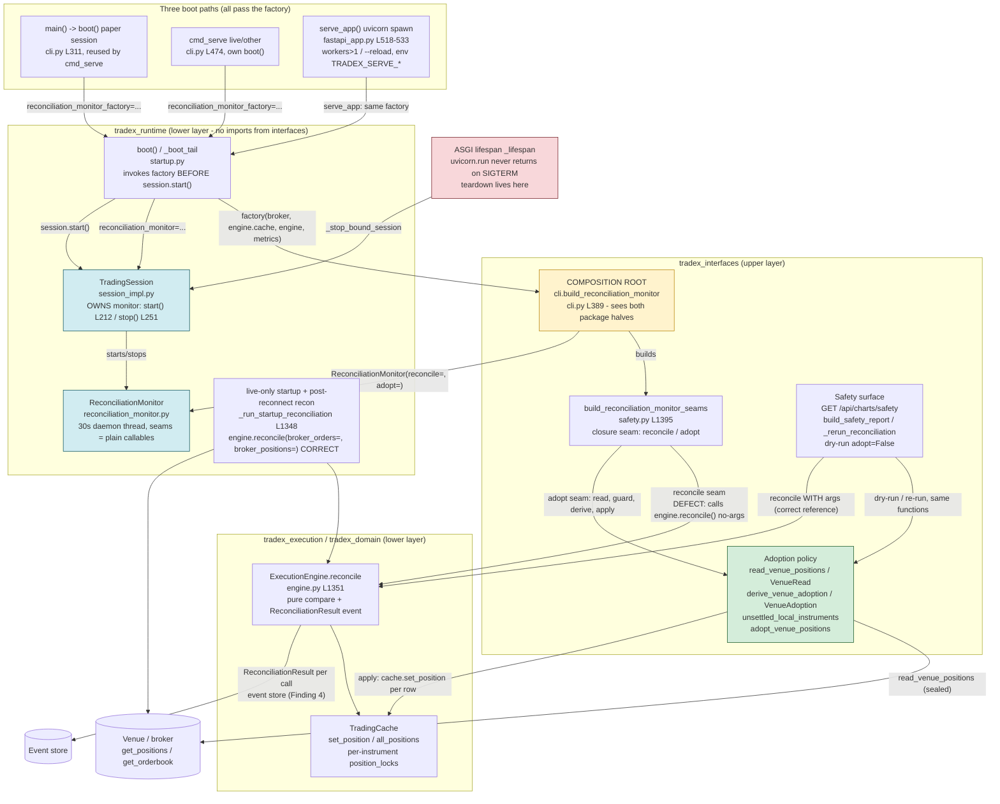
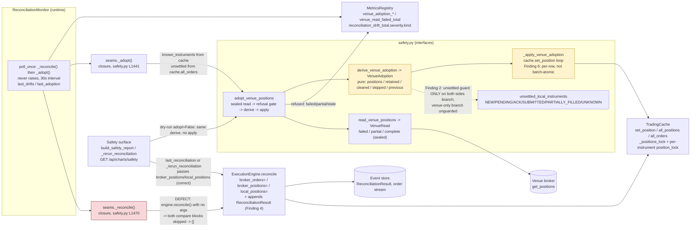
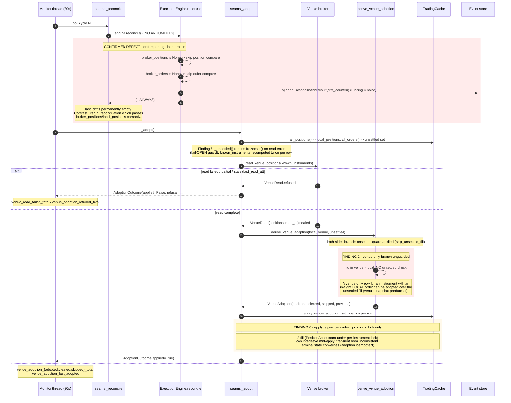

# Data and control flows (agent: flows docs)

Scope: TradeX v4 reconciliation/adoption subsystem (branch `wave0-1-recovered`). Every step cites `file:line`. Line numbers reflect the tree at the time of writing (includes the uncommitted `serve_app` factory wiring).

## 1. Boot flow (three entrypoints -> TradingSession -> session.start())

All three entrypoints converge on `runtime/src/tradex_runtime/startup.py:boot()` (startup.py:158). Package boundary: `tradex_runtime` may not import `tradex_interfaces`, so the monitor is built via a factory `build_reconciliation_monitor` defined at the one module that sees both packages, `interfaces/src/tradex_interfaces/cli.py:389`.

**Entrypoint A: `main()` -> paper boot (reused by `tradex serve`)**
1. `main()` parses args, loads env file (cli.py:259-295).
2. `boot(from_env(), reconciliation_monitor_factory=build_reconciliation_monitor)` (cli.py:309-312). The factory lives here, not in `cmd_serve`, because this paper session is the one `cmd_serve` reuses (comment cli.py:304-308).
3. `run_cli(argv, runtime)` dispatches; `finally: session.stop()` (cli.py:317-320).

**Entrypoint B: `cmd_serve` (live / non-paper boot)**
1. `cmd_serve` resolves broker/mode, runs `_require_api_key_for_live` + `_require_live_bind_loopback` (cli.py:439-445).
2. Paper + bound runtime: reuses `runtime.session` (cli.py:441, 446-449); no second boot.
3. Otherwise `boot(config, wire_strategies=False, reconciliation_monitor_factory=build_reconciliation_monitor)` (cli.py:471-475). The factory must be passed into boot, not assigned after: `boot()` calls `session.start()` before returning (comment cli.py:464-470).
4. `start_fastapi_server(session, ...)` (cli.py:477-484).

**Entrypoint C: `serve_app()` (uvicorn spawn for workers>1 / --reload)**
1. `start_fastapi_server` refuses `live + workers/reload` (fastapi_app.py:568-577) and refuses a non-READY session (fastapi_app.py:579-586).
2. Spawn path exports the serve spec to env `TRADEX_SERVE_{BROKER,MODE,HOST,API_KEY}` and calls `uvicorn.run("tradex_interfaces.fastapi_app:serve_app", factory=True, ...)` (fastapi_app.py:588-607). Single-process path builds `create_app(session)` inline and runs uvicorn in-process (fastapi_app.py:609-616).
3. `serve_app()` reads the env spec (fastapi_app.py:495-500) and calls `boot(...)` with the factory in **all three** branches: paper (fastapi_app.py:518-521), live (fastapi_app.py:522-527), other (fastapi_app.py:528-533). Missing factory here would mean spawned servers run with no reconciliation daemon at all (comment fastapi_app.py:509-513).

**Inside `boot()` -> `_boot_tail()`**
4. `boot()` sets up bus/broker/durability/single-writer lock (startup.py:372-403) and delegates to `_boot_tail(..., reconciliation_monitor=..., reconciliation_monitor_factory=...)` on both the live branch (startup.py:405-413) and the non-live branch (startup.py:425-434); both roll back via `_safe_teardown` on failure (startup.py:414-419, 435-437).
5. `_boot_tail` constructs `TradingSession(...)` (startup.py:962-1015). The monitor is built at the constructor call site: `reconciliation_monitor or reconciliation_monitor_factory(broker, engine.cache, engine, metrics)` (startup.py:989-994). This is the factory invocation point: **before** `session.start()`, so the session owns the lifecycle.
6. Order-gate proof (startup.py:1017-1033).
7. **Live-only** startup reconciliation, before `session.start()` so a new critical drift never reaches READY (comment startup.py:1035-1041):
   - no durable event store -> `trip_kill_switch("DURABLE_EVENTS_UNAVAILABLE")`, refuse start (startup.py:1044-1051);
   - else `_run_startup_reconciliation(broker, engine, session)` (startup.py:1053) -> `_install_post_reconnect_reread(broker, engine, stream_backend, session)` (startup.py:1064).
8. `_run_startup_reconciliation` (startup.py:1348): reads `broker.get_orderbook()` + `broker.get_positions()` (startup.py:1374-1382); both unavailable -> `trip_kill_switch("RECON_UNAVAILABLE")` and refuse READY (startup.py:1383-1391); `engine.reconcile(broker_orders=book, broker_positions=broker_positions)` (startup.py:1392-1394); `session.record_reconciliation(drifts)` (startup.py:1399-1400) **before** the early return so a halted session still says "checked"; extends with `_reconcile_cash` (startup.py:1405); refreshes order statuses in cache (startup.py:1406-1410); HIGH/CRITICAL drift -> `trip_kill_switch("startup_reconciliation_drift")` (startup.py:1411-1433); returns True only on a *new* trip (startup.py:1435).
9. Reconnect hook: `_install_post_reconnect_reread` (startup.py:1306) wires `stream_backend.set_reconnect_hook` to a closure calling `_run_startup_reconciliation` again (startup.py:1338-1345). Fires only on a real reconnect; refreshes `session.last_reconciliation` via step 8 so the safety surface reports the post-reconnect comparison.
10. Stop-funnel wiring: `session.stop` is wrapped to run `strategy_registry.stop_all()` then the original stop then tape close (startup.py:1079-1101).
11. Feed cold start (live only, skipped if `reconcile_tripped`): `_cold_start_feed` (startup.py:1103-1128) must prove feed readiness before READY.
12. `session.start()` (startup.py:1132) -> `TradingSession.start()` (session_impl.py:188): state NEW -> READY (session_impl.py:198), then **`feed_monitor.start()` first** (session_impl.py:201-205), then **`reconciliation_monitor.start()`** (session_impl.py:210-214). Then `strategy_registry.start_all()` (startup.py:1134-1135) and `master_scheduler.start()` (startup.py:1141-1142).

## 2. Poll flow (ReconciliationMonitor, 30s)

1. `RECONCILIATION_INTERVAL_SECONDS = 30.0` (reconciliation_monitor.py:60). Thread loop `_run`: `while not self._stop.wait(self._interval): poll_once()` (reconciliation_monitor.py:244-249). `start()` guards on `is_alive()` so a dead thread can be restarted (reconciliation_monitor.py:146-166).
2. `poll_once()` (reconciliation_monitor.py:228-240): `_reconcile()` then `_adopt()` then `_publish_metrics(drifts, adoption)`. Never raises; every failure degrades to a logged warning (docstring reconciliation_monitor.py:229-235).
3. `_reconcile()` (reconciliation_monitor.py:251-267): calls the reconcile seam with **no arguments** (reconciliation_monitor.py:259). The seam `_reconcile` (safety.py:1470-1476) calls `engine.reconcile()` with no kwargs. `ExecutionEngine.reconcile(*, broker_orders=None, broker_positions=None, local_positions=None)` (engine.py:1351-1357) skips both compare blocks when both kwargs are None (engine.py:1360-1372) and returns `[]`. **The daemon's drift comparison therefore always reports empty drift** (see Risks). Result stored as `self._last_drifts` (reconciliation_monitor.py:265-266).
4. `_adopt()` (reconciliation_monitor.py:269-280): calls the adopt seam (safety.py:1446-1468):
   - `_local()` reads `cache.all_positions()` (safety.py:1436-1444);
   - `adopt_venue_positions(broker, local_positions, cache, unsettled_instruments=_unsettled(), known_instruments=..., last_read_at=..., ...)` (safety.py:1449-1461). `_unsettled()` derives `unsettled_local_instruments(engine.all_orders())` (safety.py:1422-1434);
   - `last_read_at` advances only on `read.ok` (safety.py:1465-1467).

**Venue read decision tree, `read_venue_positions` (safety.py:1165-1228) + `adopt_venue_positions` (safety.py:1253-1316):**
- **failed**: `broker.get_positions()` raises -> `VenueRead(failed=True, failure="venue_get_positions_failed")` (safety.py:1191-1198). `VenueRead.refused` yields the reason; no mutation (safety.py:1296-1306).
- **partial**: unreadable instrument ids inside a successful call (safety.py:1201-1213), or `known_instruments` given and the venue answer names a strict subset (safety.py:1214-1227) -> read sealed with `unreadable_instruments`; refusal blocks mutation.
- **stale**: `read.read_at < last_read_at` -> refusal `"venue_read_stale"` (safety.py:1291-1295). Guards an out-of-order retry overwriting a fresher book.
- **complete**: `read.refused == ""` -> derive plan (safety.py:1307-1311); `adopt=False` returns the plan un-applied (dry run, safety.py:1312-1313); else `_apply_venue_adoption` writes `plan.positions` + `plan.cleared` via `cache.set_position` (safety.py:1314-1316, 1319-1335) and `_log_venue_adoption` logs per-row + summary (safety.py:1338-1355).

**Plan buckets, `derive_venue_adoption` (safety.py:867-984)** - `positions` / `retained` / `cleared` / `skipped` / `previous` (safety.py:905-909):
- both sides named: venue omitted -> `skipped[SKIP_VENUE_OMITTED]` unless the read proved complete (safety.py:912-923); unreadable quantity -> `SKIP_UNREADABLE_QUANTITY` (safety.py:924-930); quantity+price agree (tolerance `_ADOPTION_TOLERANCE = 0.01`, safety.py:864, 987-993) -> `retained` (safety.py:931-935); **unsettled guard**: disagreeing + instrument in `unsettled_instruments` -> `SKIP_UNSETTLED_FILL` (safety.py:936-941); venue flat -> `cleared` = `_flat_position(local) or _flat_position(venue)` (safety.py:942-947); else adopt venue figures (safety.py:949-954).
- **venue-only** (`set(venue_by_id) - set(local_by_id)`, safety.py:959-973): unreadable quantity / venue-flat skip, otherwise adopted **without any unsettled check** (see Risks).
- unreadable rows -> `SKIP_UNREADABLE_INSTRUMENT` (safety.py:975-976); result assembled at safety.py:978-984.

**Metrics + logging per poll:**
5. `_adopt` stores `self._last_adoption` and calls `_log_outcome` -> `_write_outcome_log` (reconciliation_monitor.py:277-317): refusal at WARNING with the read dict (reconciliation_monitor.py:294-299); empty plan at INFO (reconciliation_monitor.py:302-306); otherwise per-row WARNING + summary WARNING with the four bucket counts (reconciliation_monitor.py:308-317).
6. `_publish_metrics` -> `_write_metrics` (reconciliation_monitor.py:319-368): see Metric flow (section 5). Never raises (reconciliation_monitor.py:336-342).

## 3. Safety surface flow (GET /api/charts/safety)

1. Route `get_safety` (interfaces/src/tradex_interfaces/routes/chart.py:795) is a shell: `build_safety_report(session).to_wire()` (chart.py:803-810); `session=None` still answers (chart.py:809).
2. `build_safety_report` (safety.py:507-555):
   - orders: `engine.cache.all_orders` (safety.py:521-523);
   - **event stream split**: `_replay_for_safety(event_store)` (safety.py:525-526) replays `"orders"` and `"system"` separately (safety.py:558-580). Order lifecycle events date UNKNOWN orders; `ReconciliationResult` is routed to `"system"` by `sqlite_event_store` (sqlite_event_store.py:134) and dates the last check. Reading only `"orders"` made `last_checked_at` structurally unreachable (comment safety.py:532-538).
   - UNKNOWN orders: `unresolved_unknown_orders(orders, _unknown_transition_times(order_events), now)` (safety.py:528-530).
   - reconciliation: `_reconciliation(session, system_events)` (safety.py:539) -> facts -> `severity_totals` + `refuses_boot` count (safety.py:540-541).
   - strategies: `_strategy_rows(session)` from strategy registry + validation_report_store (safety.py:551).
   - report fields: feed (`feed_state`), unknown_orders, reconciliation, strategies, `boot_refused`, `reconciliation_checked`, `drift` facts (safety.py:543-555).
3. `_reconciliation` (safety.py:583-600): `last_checked_at` = timestamp of the **last** `ReconciliationResult` in the system stream (safety.py:594-595). Drift items: `session.last_reconciliation` if set (safety.py:597-598), else **re-run fallback** `_rerun_reconciliation(session)` (safety.py:599).
4. `_rerun_reconciliation` (safety.py:603-621): side-effect-free `engine.reconcile(broker_positions=venue_positions, local_positions=positions)` (safety.py:616-619) - note it passes the kwargs correctly, unlike the daemon seam. A venue read failure degrades to `[]`; `reconciliation_checked=False` carries "could not check" vs "checked, found nothing" (docstring safety.py:604-610).
5. Facts are re-derived from drift items' observations via `derive_severity`, **not** their stored severities (docstring safety.py:586-590).

## 4. Teardown flow (SIGTERM/SIGINT -> lifespan -> session.stop())

1. Signals: `uvicorn.run` wraps serving in `capture_signals`, restores default handlers and re-raises the captured signal **inside** its `with` block, so `run()` never returns and a caller `finally` is skipped for SIGTERM (SIG_DFL kills the process). This is why teardown lives in the ASGI lifespan (comment fastapi_app.py:102-115).
2. `_lifespan` (fastapi_app.py:100-120): `try: yield finally: _stop_bound_session(app.state.session)` (fastapi_app.py:117-120). ASGI lifespan shutdown completes inside uvicorn's `_serve()` **before** the signal re-raise, so this runs for SIGTERM, SIGINT, and covers workers>1/reload child sessions `serve_app` built (fastapi_app.py:112-115).
3. `_stop_bound_session` (fastapi_app.py:82-97): calls `session.stop()` if present, swallowing and logging teardown errors.
4. `TradingSession.stop()` ordering (session_impl.py:216-298):
   - idempotent early-out if STOPPED (session_impl.py:221-222); release single-writer lock first, even from NEW (session_impl.py:227-232); NEW -> return (nothing else running, session_impl.py:233-234);
   - cancel bus subscriptions (session_impl.py:235-237);
   - `feed_monitor.stop()` (session_impl.py:240-245);
   - **`reconciliation_monitor.stop()` before broker teardown** so a poll cannot observe a half-stopped broker (session_impl.py:249-254);
   - `market_feed.stop()` (session_impl.py:255-259), `mark_to_market.close()` (session_impl.py:260-264), `bus.dispose()` (session_impl.py:265), `fill_bridge.close()` (session_impl.py:266-270), `stream_backend.close()` (session_impl.py:271-278), `master_scheduler.stop()` (session_impl.py:280-285), `broker.close()` last (session_impl.py:290-295); state -> STOPPED (session_impl.py:296).
   - The stop-funnel wrapper (startup.py:1083-1101) runs `strategy_registry.stop_all()` before, and tape close after, the above.
5. `cmd_serve` `finally`: stops a session it booted itself; a **reused** paper session is left to `main()`'s own `finally` (cli.py:490-492, 417-320).
6. What each path cleans:
   - **single-process** (`create_app(session)` + `uvicorn.run(app)`): one session; cleaned by `_lifespan` on any signal, plus `cmd_serve`/`main` finally as backstop for pre-serve failures. `_safe_teardown` (startup.py:440) covers boot failures mid-construction.
   - **spawn** (`serve_app` factory): each worker/reload child builds its own session at import; parent's `cmd_serve` finally never sees them. Cleanup depends entirely on `_lifespan` in each child - which is exactly what the lifespan comment names (fastapi_app.py:113-115). Env serve spec is set before `uvicorn.run` (fastapi_app.py:592-598) and cleared on the single-process path (fastapi_app.py:611-614).

## 5. Metric flow (emitter -> counter/gauge)

| Metric | Emitter | Kind | Trigger |
|---|---|---|---|
| `venue_adoption_adopted_total` | `reconciliation_monitor._write_metrics` (reconciliation_monitor.py:351) | counter | applied adoption, +len(plan.positions) |
| `venue_adoption_cleared_total` | reconciliation_monitor.py:352 | counter | applied adoption, +len(plan.cleared) |
| `venue_adoption_last_adopted` | reconciliation_monitor.py:353-355 | gauge | applied adoption, set to len(plan.positions) |
| `venue_adoption_refused_total{reason}` | reconciliation_monitor.py:357-359 | counter | refused adoption |
| `venue_adoption_skipped_total{reason}` | reconciliation_monitor.py:362-369 | counter | per skipped reason, applied or refused |
| `venue_read_failed_total` | reconciliation_monitor.py:346-347 | counter | `read.failed` |
| `reconciliation_drift_total.<severity>.<kind>` | `ExecutionEngine.reconcile` (engine.py:1373-1385) | counter | per drift item, only when `drifts` non-empty |

- **Duplicate-literal contract**: the adoption metric names exist as literals in **both** `reconciliation_monitor.py:75-80` (`_METRIC_*`) and `safety.py:1358-1370` (`METRIC_*`), because runtime may not import interfaces (comment safety.py:1358-1359). The two sets must agree; `test_reconciliation_monitor.py::test_metric_names_are_the_prometheus_contract` pins them. `deploy/prometheus-rules.yml:20-21` documents the `reconciliation_drift_total.<severity>.<kind>` -> `..._<severity>_<kind>` normalization.
- **Ownership split**: the monitor emits only the adoption metrics (its family); drift counters are the engine's (comment reconciliation_monitor.py:324-330). Note the docstring says "the adopter's business", but the actual emitter is `engine.reconcile`, which only runs inside `_reconcile` - see Risks.
- **Stored-severity divergence**: `engine.reconcile` labels `reconciliation_drift_total` with `DriftItem.severity` **as stored** (engine.py:1377-1385), while the AC-17 surface re-derives severity from the item's facts (`derive_severity`, docstring safety.py:586-590). The safety.py docstring explicitly records that stored values contradict AC-17 (MEDIUM exists in stored severities; status-mismatch is LOW stored vs HIGH derived). Prometheus alerts fire on the stored label, so the alert surface and the safety surface can disagree about the same drift item.

## Flow-level risks (per brief)

1. **Reconcile seam is a no-op** (breaks Poll flow step 3 and the monitor's "report drift exactly as before" claim): `_reconcile` calls `engine.reconcile()` with no kwargs (safety.py:1474); both compare blocks are keyed on `broker_positions is not None` / `broker_orders is not None` (engine.py:1360-1372), so the daemon's `last_drifts` is permanently empty (verified empirically: no-arg reconcile -> 0 drift items). Correction still happens via the adopt seam's own venue read, but drift *reporting* from the daemon is structurally dead, and `record_reconciliation` is only called from startup.py:1399 (startup + reconnect paths) - never by the poll - so `session.last_reconciliation` never reflects a daemon poll at all.
2. **Venue-only unsettled gap** (breaks the Poll flow plan-bucket guarantee): `derive_venue_adoption`'s venue-only branch (safety.py:959-973) skips the `iid in unsettled` check that guards the both-sides branch (safety.py:936-941). A venue-only row for an instrument with an in-flight LOCAL order can be adopted over a fill the venue snapshot predates. The docstring's "An unsettled fill is never adopted over" (safety.py:822-846) claims unqualified protection the code does not give. Related fail-open: `_unsettled()` returns `frozenset()` when orders cannot be read (safety.py:1430-1434), silently disabling the guard it does have.
3. **Per-poll `ReconciliationResult` append** (breaks Safety flow step 3 dating and grows the log): `engine.reconcile` appends `ReconciliationResult(drift_count=...)` to the event store on **every** call (engine.py:1387), and the monitor calls it every 30s. Harmless today only because risk 1 makes each append say `drift_count=0`; once the seam is fixed this appends a system-stream event every 30s forever (unbounded event-log growth) and continuously rewrites `last_checked_at` (safety.py:594-595), while the appended `drift_count` describes a comparison the safety surface then ignores in favour of re-derived facts.

Secondary notes (not on the brief's list, but flow-visible): `_cleared_position` (safety.py:1022-1028) is dead code (the clear path inlines `_flat_position`, safety.py:946); `_apply_venue_adoption` writes positions one at a time with no multi-key atomicity (safety.py:1334-1335), so a fill racing an adoption apply can interleave per-instrument writes (terminal state converges; transient book can be inconsistent); the `_write_metrics` docstring attributes drift counters to "the adopter" while the actual emitter is `engine.reconcile` (reconciliation_monitor.py:326-328 vs engine.py:1373-1385).

# Design diagrams (agent: arch diagrams)


Proposed target design for lane 5e (reconcile + adopt). Grounded in the verified
findings brief `recon-review-findings` and a fresh read of
`reconciliation_monitor.py`, `safety.py`, `cli.py`, `startup.py`, `session_impl.py`,
`fastapi_app.py`, `engine.py`, `trading_cache.py`.

Key invariants the design keeps:

- `tradex_runtime` may NOT import `tradex_interfaces` (pinned by
  `tests/test_import_boundaries.py`). The join of adoption policy and the OMS
  book belongs in `tradex_interfaces`; the timer belongs in `tradex_runtime`.
- The session owns the monitor lifecycle (start in `start()`, stop in `stop()`
  before broker teardown).
- Adoption is gated by the sealed `VenueRead` (failed/partial/stale refused
  before mutation) and by `unsettled_local_instruments`.

## 1. Architecture: packages, composition root, boot convergence



Composition root stays in `tradex_interfaces.cli` (the only module that can see
both halves). The factory seam is the *only* thing crossing the package
boundary downward: `boot()` receives `reconciliation_monitor_factory` and calls
it inside `_boot_tail` **before** `session.start()` (startup.py L989-994), so a
monitor assigned post-hoc would never be started. The session owns the monitor
from that point; the monitor's seams are plain closures, so `tradex_runtime`
never sees an `interfaces` type.

## 2. Component diagram: the reconcile/adopt subsystem



## 3. Sequence: one 30s poll cycle (with the two confirmed defects)



## 4. Lifecycle: monitor, session ordering, ASGI teardown, spawn paths

```mermaid
stateDiagram-v2
  direction TB

  state "Monitor lifecycle" as MON {
    [*] --> Constructed: build_reconciliation_monitor<br/>composition root, BEFORE session.start()
    Constructed --> Running: session.start() -> monitor.start()
    Running --> Running: poll every 30s (poll_once never raises)
    Running --> ThreadDead: unhandled seam error
    ThreadDead --> Running: start() again (guard is is_alive,<br/>restartable after death)
    Running --> Stopped: session.stop() -> monitor.stop()<br/>join(5s), BEFORE broker teardown
    Stopped --> Running: start() (restartable)
    Stopped --> [*]
    Constructed --> [*]: session never started (stop() no-ops on NEW)
  }

  state "Session start ordering (boot)" as SORDER {
    [*] --> Building: _boot_tail builds services
    Building --> MonitorBuilt: factory(broker, engine.cache, engine, metrics)<br/>startup.py L989
    MonitorBuilt --> StartupRecon: live only: _run_startup_reconciliation<br/>BEFORE session.start() (C2: no READY over critical drift)
    StartupRecon --> Started: session.start()<br/>feed_monitor.start() then reconciliation_monitor.start()
    Started --> [*]
  }

  state "Session stop ordering" as TORDER {
    [*] --> StopSignalled
    StopSignalled --> MonitorsStopped: feed_monitor.stop() then<br/>reconciliation_monitor.stop()
    MonitorsStopped --> BrokerClosed: market feed, MTM, bus,<br/>fill bridge, stream, master scheduler, broker.close()
    BrokerClosed --> [*]
  }

  state "Process / spawn paths" as SPAWN {
    state "path 1: main()->boot() paper, cmd_serve reuses session" as P1
    state "path 2: cmd_serve live/other, own boot()" as P2
    state "path 3: serve_app() uvicorn workers>1/--reload spawn<br/>env TRADEX_SERVE_*; live refused with workers/reload" as P3
    [*] --> P1
    [*] --> P2
    [*] --> P3
    P1 --> LIFE
    P2 --> LIFE
    P3 --> LIFE
  }

  state "ASGI lifespan teardown" as LIFE {
    [*] --> Serving: yield
    Serving --> Teardown: finally: _stop_bound_session(app.state.session)
    Note right of Teardown: uvicorn.run never returns on SIGTERM<br/>(capture_signals re-raises, disposition SIG_DFL).<br/>Caller-side finally is unreachable;<br/>lifespan shutdown runs before the re-raise,<br/>covering workers/reload child sessions too.
    Teardown --> [*]: then session.stop() (TORDER)
  }

  Started --> StopSignalled: stop() / lifespan / cmd_serve finally
```

## Design changes proposed

**1. Fix the reconcile seam (confirmed defect).** `seams._reconcile` currently
calls `engine.reconcile()` with no arguments, which skips both compare blocks and
always returns `[]` - the "reports drift exactly as before" claim is false and
`last_drifts` is permanently empty. Change the closure to mirror
`_rerun_reconciliation` (safety.py L603): read `engine.cache.all_positions()` and
`broker.get_positions()` once, then call
`engine.reconcile(broker_positions=venue_positions, local_positions=positions)`.
Even better: have the adopt seam share that single venue read (read once per poll,
derive both drift and adoption from it) so the reconcile and adopt halves cannot
disagree and the venue's rate-limited endpoint is hit once per 30s, not twice.
Orders drift (`compare_orders`) stays out of the seam or gets the same treatment
via `broker.get_orderbook()` - decide explicitly, since startup reconciliation
does compare orders.

**2. Apply the unsettled guard to the venue-only branch (Finding 2).** In
`derive_venue_adoption`, the loop over `set(venue_by_id) - set(local_by_id)`
never consults `unsettled_instruments`, so a venue-only row for an instrument
with an in-flight local order can be adopted over the unsettled fill. The fix is
symmetric and cheap: before `_adopted_position(None, venue)`, skip with
`SKIP_UNSETTLED_FILL` when `iid in unsettled`, exactly as the both-sides branch
does at L936. This makes the docstring's "An unsettled fill is never adopted
over" true on every branch. Also close the Finding 5 fail-open: when
`_unsettled()` cannot read orders, the guard should fail CLOSED (treat all
instruments as unsettled, or refuse the adoption with a distinct refusal code)
rather than silently returning `frozenset()` and adopting unguarded.

**3. Batch-atomic adoption apply - yes, under one lock (Finding 6).**
`_apply_venue_adoption` writes `positions + cleared` one `set_position` at a
time, each under only `_positions_lock` for that single call; a fill writing
under a per-instrument `position_lock` can interleave mid-apply, so the
transient book mixes pre- and post-adoption rows (strategies reading between
writes see an inconsistent book). Terminal state converges, but the transient is
observable. Proposal: give `TradingCache` a single batch write,
`set_positions(Sequence[Position])`, that takes `_positions_lock` once and swaps
the whole row set under it (and, where per-instrument RMW matters, acquires the
per-instrument locks in sorted-key order to stay deadlock-free against the fill
path). The plan is already a complete, pure `VenueAdoption` - the apply should
match its all-or-nothing semantics. Keep it best-effort-free: if the cache lacks
the batch method, keep today's per-row loop as a fallback but log it as
non-atomic.

Adjacent (cheap, in scope of the same edit): Finding 4 - once the seam is fixed,
`engine.reconcile` appends `ReconciliationResult` every 30s forever. Keep the
append but only on drift (or drop the count when zero) so the system stream does
not grow one row per half-minute. Finding 3 - delete dead `_cleared_position`
(superseded by the inline `_flat_position` fallback).
