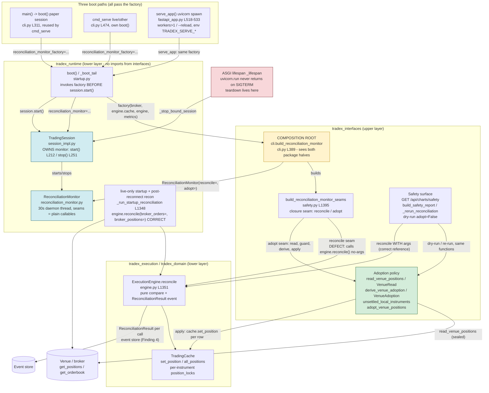
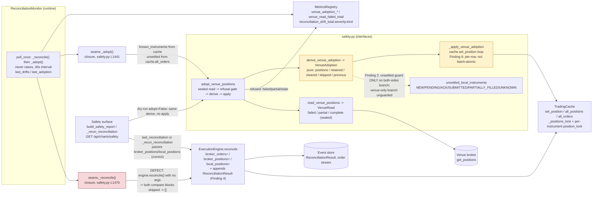
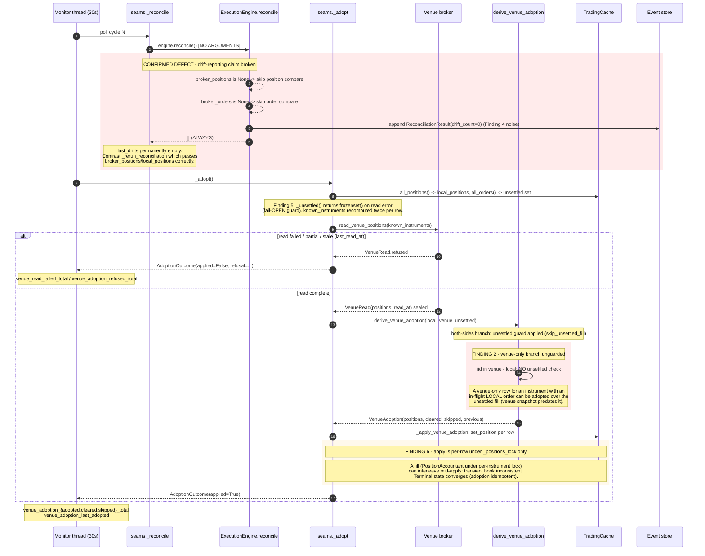

# Reconciliation / adoption subsystem - TARGET architecture (2026-09-28)

Proposed target design for lane 5e (reconcile + adopt). Grounded in the verified
findings brief `recon-review-findings` and a fresh read of
`reconciliation_monitor.py`, `safety.py`, `cli.py`, `startup.py`, `session_impl.py`,
`fastapi_app.py`, `engine.py`, `trading_cache.py`.

Key invariants the design keeps:

- `tradex_runtime` may NOT import `tradex_interfaces` (pinned by
  `tests/test_import_boundaries.py`). The join of adoption policy and the OMS
  book belongs in `tradex_interfaces`; the timer belongs in `tradex_runtime`.
- The session owns the monitor lifecycle (start in `start()`, stop in `stop()`
  before broker teardown).
- Adoption is gated by the sealed `VenueRead` (failed/partial/stale refused
  before mutation) and by `unsettled_local_instruments`.

## 1. Architecture: packages, composition root, boot convergence



Composition root stays in `tradex_interfaces.cli` (the only module that can see
both halves). The factory seam is the *only* thing crossing the package
boundary downward: `boot()` receives `reconciliation_monitor_factory` and calls
it inside `_boot_tail` **before** `session.start()` (startup.py L989-994), so a
monitor assigned post-hoc would never be started. The session owns the monitor
from that point; the monitor's seams are plain closures, so `tradex_runtime`
never sees an `interfaces` type.

## 2. Component diagram: the reconcile/adopt subsystem



## 3. Sequence: one 30s poll cycle (with the two confirmed defects)



## 4. Lifecycle: monitor, session ordering, ASGI teardown, spawn paths

```mermaid
stateDiagram-v2
  direction TB

  state "Monitor lifecycle" as MON {
    [*] --> Constructed: build_reconciliation_monitor<br/>composition root, BEFORE session.start()
    Constructed --> Running: session.start() -> monitor.start()
    Running --> Running: poll every 30s (poll_once never raises)
    Running --> ThreadDead: unhandled seam error
    ThreadDead --> Running: start() again (guard is is_alive,<br/>restartable after death)
    Running --> Stopped: session.stop() -> monitor.stop()<br/>join(5s), BEFORE broker teardown
    Stopped --> Running: start() (restartable)
    Stopped --> [*]
    Constructed --> [*]: session never started (stop() no-ops on NEW)
  }

  state "Session start ordering (boot)" as SORDER {
    [*] --> Building: _boot_tail builds services
    Building --> MonitorBuilt: factory(broker, engine.cache, engine, metrics)<br/>startup.py L989
    MonitorBuilt --> StartupRecon: live only: _run_startup_reconciliation<br/>BEFORE session.start() (C2: no READY over critical drift)
    StartupRecon --> Started: session.start()<br/>feed_monitor.start() then reconciliation_monitor.start()
    Started --> [*]
  }

  state "Session stop ordering" as TORDER {
    [*] --> StopSignalled
    StopSignalled --> MonitorsStopped: feed_monitor.stop() then<br/>reconciliation_monitor.stop()
    MonitorsStopped --> BrokerClosed: market feed, MTM, bus,<br/>fill bridge, stream, master scheduler, broker.close()
    BrokerClosed --> [*]
  }

  state "Process / spawn paths" as SPAWN {
    state "path 1: main()->boot() paper, cmd_serve reuses session" as P1
    state "path 2: cmd_serve live/other, own boot()" as P2
    state "path 3: serve_app() uvicorn workers>1/--reload spawn<br/>env TRADEX_SERVE_*; live refused with workers/reload" as P3
    [*] --> P1
    [*] --> P2
    [*] --> P3
    P1 --> LIFE
    P2 --> LIFE
    P3 --> LIFE
  }

  state "ASGI lifespan teardown" as LIFE {
    [*] --> Serving: yield
    Serving --> Teardown: finally: _stop_bound_session(app.state.session)
    Note right of Teardown: uvicorn.run never returns on SIGTERM<br/>(capture_signals re-raises, disposition SIG_DFL).<br/>Caller-side finally is unreachable;<br/>lifespan shutdown runs before the re-raise,<br/>covering workers/reload child sessions too.
    Teardown --> [*]: then session.stop() (TORDER)
  }

  Started --> StopSignalled: stop() / lifespan / cmd_serve finally
```

## Design changes proposed

**1. Fix the reconcile seam (confirmed defect).** `seams._reconcile` currently
calls `engine.reconcile()` with no arguments, which skips both compare blocks and
always returns `[]` - the "reports drift exactly as before" claim is false and
`last_drifts` is permanently empty. Change the closure to mirror
`_rerun_reconciliation` (safety.py L603): read `engine.cache.all_positions()` and
`broker.get_positions()` once, then call
`engine.reconcile(broker_positions=venue_positions, local_positions=positions)`.
Even better: have the adopt seam share that single venue read (read once per poll,
derive both drift and adoption from it) so the reconcile and adopt halves cannot
disagree and the venue's rate-limited endpoint is hit once per 30s, not twice.
Orders drift (`compare_orders`) stays out of the seam or gets the same treatment
via `broker.get_orderbook()` - decide explicitly, since startup reconciliation
does compare orders.

**2. Apply the unsettled guard to the venue-only branch (Finding 2).** In
`derive_venue_adoption`, the loop over `set(venue_by_id) - set(local_by_id)`
never consults `unsettled_instruments`, so a venue-only row for an instrument
with an in-flight local order can be adopted over the unsettled fill. The fix is
symmetric and cheap: before `_adopted_position(None, venue)`, skip with
`SKIP_UNSETTLED_FILL` when `iid in unsettled`, exactly as the both-sides branch
does at L936. This makes the docstring's "An unsettled fill is never adopted
over" true on every branch. Also close the Finding 5 fail-open: when
`_unsettled()` cannot read orders, the guard should fail CLOSED (treat all
instruments as unsettled, or refuse the adoption with a distinct refusal code)
rather than silently returning `frozenset()` and adopting unguarded.

**3. Batch-atomic adoption apply - yes, under one lock (Finding 6).**
`_apply_venue_adoption` writes `positions + cleared` one `set_position` at a
time, each under only `_positions_lock` for that single call; a fill writing
under a per-instrument `position_lock` can interleave mid-apply, so the
transient book mixes pre- and post-adoption rows (strategies reading between
writes see an inconsistent book). Terminal state converges, but the transient is
observable. Proposal: give `TradingCache` a single batch write,
`set_positions(Sequence[Position])`, that takes `_positions_lock` once and swaps
the whole row set under it (and, where per-instrument RMW matters, acquires the
per-instrument locks in sorted-key order to stay deadlock-free against the fill
path). The plan is already a complete, pure `VenueAdoption` - the apply should
match its all-or-nothing semantics. Keep it best-effort-free: if the cache lacks
the batch method, keep today's per-row loop as a fallback but log it as
non-atomic.

Adjacent (cheap, in scope of the same edit): Finding 4 - once the seam is fixed,
`engine.reconcile` appends `ReconciliationResult` every 30s forever. Keep the
append but only on drift (or drop the count when zero) so the system stream does
not grow one row per half-minute. Finding 3 - delete dead `_cleared_position`
(superseded by the inline `_flat_position` fallback).
